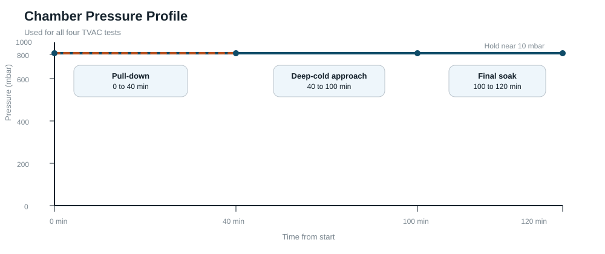
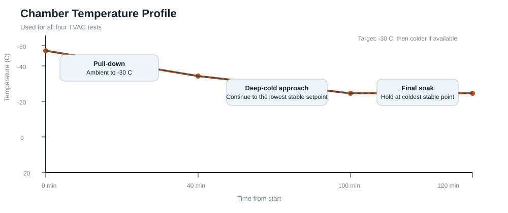

# Envisys Tech TVAC Test Plan - Jetson with Copper Straps and Radiator Variants

**Project:** balloon-ttp  
**Purpose:** provide a short, technician-ready TVAC plan for four quick thermal checks of the Jetson payload with the latest radiator/strap setup.  
**Test window:** 8 hours total  
**Setup location:** Envisys Tech TVAC chamber

## 1. Objective

We need to screen four payload configurations within one 8-hour chamber window:

1. Jetson at 30 W with both radiators
2. Jetson at 10 W with both radiators
3. Jetson at 10 W with a single radiator
4. Jetson at 30 W with a single radiator

Because the chamber run is much shorter than the full flight timeline to 40 km and return, the test should use a compressed cold-soak profile that reaches the chamber's low-temperature region quickly and then holds long enough to capture thermal response.

## 2. Test Philosophy

Use one common chamber profile for all four tests. Only the hardware configuration and Jetson power level change between runs.

The technician noted the chamber typically needs about 30 to 40 minutes to reach 10 mbar and -30 C, then roughly another hour to pull down further. That fits a practical quick-screening profile for these four cases.

## 3. Proposed Chamber Profile

Use the same profile for each test unless the chamber has a better verified equivalent.

### 3.0 Client-Supplied Reference Profile

This figure was supplied in the inputs folder and shows the temperature profile we want the technician to use as the reference when setting up the chamber sequence.

The chamber test does not need to reproduce the full profile exactly. It needs to capture the same thermal intent within the available 8-hour window: a strong pull-down, a low-pressure hold, and enough dwell to compare the four payload configurations.

### 3.1 Profile Figures

The same chamber profile is shown in both figures below. Figure 1 is the pressure timeline; Figure 2 is the temperature timeline.

| Stage | Time from start | Chamber pressure | Chamber temperature | Purpose |
| --- | ---: | ---: | ---: | --- |
| 1. Pull-down | 0 to 40 min | Ramp to 10 mbar | Ramp to -30 C | Get the chamber into the cold/vacuum region quickly |
| 2. Deep-cold approach | 40 to 100 min | Hold near 10 mbar | Continue lowering to the coldest stable setpoint the chamber can reach, target -40 C or lower if available | Drive the payload toward the limiting cold condition |
| 3. Final soak | 100 to 120 min | Hold near 10 mbar | Hold at the deepest stable cold setpoint | Capture the comparison data before the next hardware change |

If the chamber cannot reliably reach -40 C, use the lowest stable temperature it can maintain and record the actual profile in the log.

## 4. Test Matrix

| Test | Hardware configuration | Jetson load | Chamber profile | Notes |
| --- | --- | ---: | --- | --- |
| 1 | Both radiators installed | 30 W | Shared profile above | Highest-load check on the full-radiator build |
| 2 | Both radiators installed | 10 W | Shared profile above | Lower-load check on the full-radiator build |
| 3 | Single radiator installed | 10 W | Shared profile above | Lower-stress case for the single-radiator build |
| 4 | Single radiator installed | 30 W | Shared profile above | Highest-stress case and the key risk case |

Recommended order is 1 -> 2 -> 3 -> 4 so the full-radiator 30 W and 10 W cases are verified first, then the more severe single-radiator configuration.

## 5. 8-Hour Execution Plan

This schedule assumes each test uses about 2 hours including pull-down, soak, and a short configuration changeover.

| Window | Activity |
| --- | --- |
| 0:00 to 2:00 | Test 1: 30 W, both radiators |
| 2:00 to 2:10 | Changeover and logging review |
| 2:10 to 4:10 | Test 2: 10 W, both radiators |
| 4:10 to 4:20 | Changeover and logging review |
| 4:20 to 6:20 | Test 3: 10 W, single radiator |
| 6:20 to 6:30 | Changeover and logging review |
| 6:30 to 8:00 | Test 4: 30 W, single radiator |

If the chamber pull-down runs slower than expected, shorten the final soak on the earlier cases and preserve the last case, since the 30 W single-radiator test is the most demanding one.

## 6. What To Record For Each Test

Please capture the following for every run:

- Chamber pressure versus time
- Chamber temperature versus time
- Jetson temperature versus time
- Radiator temperature versus time
- Start and end timestamps for the test
- Any control notes during changeover or hold

Recommended logging interval: 30 to 60 seconds.

## 7. Technician Notes

- Keep the same chamber profile for all four tests so the only variables are load and radiator count.
- Confirm whether the chamber temperature should be held at the lowest stable setpoint or stepped in stages below -30 C; either is acceptable as long as the actual profile is logged.
- If a configuration change requires extra time, preserve the 30 W single-radiator case as the final priority case.
- If the chamber can only hold one low setpoint, do not overcomplicate the profile - the useful part of the test is the cold-vacuum exposure, not an exact flight-time match.

## 8. Suggested Outcome

At the end of the 8-hour window, we should have a direct comparison of the four combinations under a consistent cold-vacuum profile, enough to identify whether the second radiator materially reduces Jetson temperature and whether the single-radiator setup is acceptable at 10 W and 30 W.