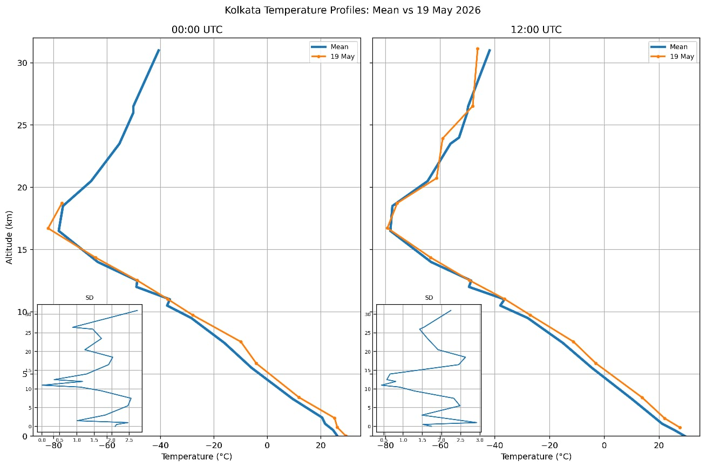
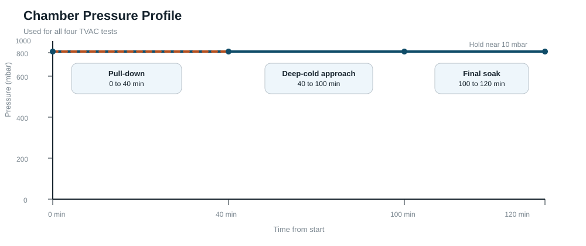
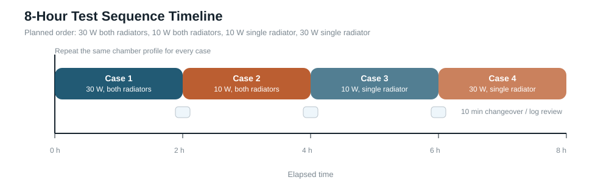

# Envisys Tech TVAC Test Plan: Jetson with Copper Straps and Radiator Variants

**Project:** balloon-ttp  
**Deliverable:** technician-facing TVAC test plan with figures and source files  
**Facility:** Envisys Tech TVAC chamber  
**Test window:** 8 hours total  
**Prepared for:** chamber technician and test lead

## 1. Executive Summary

This document defines a single, repeatable TVAC sequence for screening the latest Jetson payload configuration with copper straps and two radiator options. The goal is to execute four quick thermal tests inside one 8-hour chamber window, using one common chamber profile for all cases so the only meaningful variables are payload power and radiator count.

The four required cases are:

1. Jetson at 30 W with both radiators
2. Jetson at 10 W with both radiators
3. Jetson at 10 W with a single radiator
4. Jetson at 30 W with a single radiator

The chamber operator reported that it typically takes 30 to 40 minutes to reach about 10 mbar and -30 C, then about another hour to pull down further. That behavior is consistent with a useful screening profile: a controlled pull-down to low pressure and low temperature, followed by a hold long enough to compare thermal response between the four configurations.

The immediate purpose of the test is not to reproduce the full flight profile to 40 km. It is to determine, in a short and controlled chamber run, whether the latest radiator setup keeps the Jetson within an acceptable thermal range, and whether the single-radiator configuration is acceptable at both 10 W and 30 W.

## 2. What Needs To Be Achieved

The test campaign should answer four practical questions:

- Does the latest dual-radiator configuration hold the Jetson thermally better than the single-radiator configuration?
- Does the Jetson remain well controlled at 10 W with both radiators?
- Does the single-radiator arrangement remain usable at 10 W, or does it approach an unacceptable temperature rise?
- Does the single-radiator arrangement remain acceptable at 30 W, or is it clearly a risk case?

The technician should carry out the sequence so that all four cases are directly comparable. That means the chamber profile must be the same for every case, the logging must be consistent, and the changeovers between cases must be recorded.

## 3. Test Article and Cases

| Case | Hardware configuration | Jetson power | Why it matters |
| --- | --- | ---: | --- |
| 1 | Both radiators installed | 30 W | Highest load with the strongest thermal hardware |
| 2 | Both radiators installed | 10 W | Lower load baseline for the full-radiator build |
| 3 | Single radiator installed | 10 W | Lower-stress check of the reduced-radiator build |
| 4 | Single radiator installed | 30 W | Highest-stress and most important risk case |

The recommended order is Case 1 -> Case 2 -> Case 3 -> Case 4. That sequence verifies the stronger configuration first, then moves to the more severe single-radiator cases later in the 8-hour window.

## 4. Chamber Profile

Use the same profile for all four tests unless the chamber has a validated better equivalent. The operator should log the actual chamber behavior against the requested profile so the results can be compared later.

### 4.0 Client-Supplied Reference Profile

This is the temperature profile supplied in the inputs folder. It is the reference the technician should use when setting up the chamber sequence and explaining what the TVAC run is intended to approximate.

The chamber run does not try to reproduce this entire flight profile exactly. Instead, it reproduces the important thermal intent of the supplied profile within the available 8-hour chamber window: a strong pull-down, a low-pressure hold, and enough dwell to compare the hardware configurations.

### 4.1 Pressure Profile

The pressure target is a quick pull-down to about 10 mbar in roughly 30 to 40 minutes, then a stable hold near that level for the rest of the test.

### 4.2 Temperature Profile

The temperature target is to reach about -30 C during the first pull-down window, then continue lowering to the coldest stable setpoint the chamber can maintain. If the chamber cannot reliably reach -40 C, use the lowest stable temperature available and log the actual achieved value.

### 4.3 Why This Profile

This profile is intended to stress the payload in a practical TVAC window without pretending to be the full flight trajectory. The key requirement is comparability: each case should see the same chamber environment, so the temperature response differences come from the hardware setup and power level rather than from a different thermal history.

## 5. 8-Hour Execution Timeline

The planned pacing is one case every two hours, including pull-down, cold soak, and a short changeover review. If the chamber pull-down is slower than expected, preserve the final case as the priority case and shorten earlier soaks if necessary.

| Window | Activity |
| --- | --- |
| 0:00 to 2:00 | Case 1: 30 W, both radiators |
| 2:00 to 2:10 | Changeover and log review |
| 2:10 to 4:10 | Case 2: 10 W, both radiators |
| 4:10 to 4:20 | Changeover and log review |
| 4:20 to 6:20 | Case 3: 10 W, single radiator |
| 6:20 to 6:30 | Changeover and log review |
| 6:30 to 8:00 | Case 4: 30 W, single radiator |

## 6. Detailed Technician Procedure

### 6.1 Before the First Run

- Confirm the payload configuration matches Case 1.
- Verify the chamber instrumentation is ready and zeroed.
- Confirm temperature and pressure logging is active.
- Check that the payload power command can be set to 30 W and 10 W on demand.
- Confirm the chamber operator is aware that the same profile will be repeated four times.

### 6.2 During Each Test

For each case, the technician should:

1. Start from the agreed initial chamber condition.
2. Pull down toward 10 mbar and -30 C over the first 30 to 40 minutes.
3. Continue lowering the chamber temperature to the coldest stable setpoint available.
4. Hold that condition long enough to capture the Jetson thermal response.
5. Record any anomalies, control adjustments, or deviations from the requested profile.

### 6.3 Between Tests

- Change only what is needed for the next case: Jetson power level or radiator configuration.
- Record the time required for the changeover.
- If the chamber profile must be shortened, keep the last 30 W single-radiator case as the priority run.

## 7. What To Record

Capture the following for every case:

- Chamber pressure versus time
- Chamber temperature versus time
- Jetson temperature versus time
- Radiator temperature versus time
- Payload power level and start time
- End time for the run
- Any control notes during pull-down, soak, or changeover

Recommended logging interval: 30 to 60 seconds.

## 8. What Success Looks Like

The test campaign is successful if the technician returns with a clean comparison set for the four cases under one common chamber profile. The result should make it obvious:

- whether the second radiator provides a meaningful thermal benefit,
- whether the 10 W cases stay comfortably controlled,
- whether the 30 W single-radiator case is acceptable or clearly risky,
- and whether the profile and log quality are good enough to support the next hardware decision.

At minimum, the final package should allow the engineering team to compare the four cases directly without guessing about chamber history or changeover conditions.

## 9. Files and Figures Used

| Type | File |
| --- | --- |
| Source plan | [envisys-tvac-test-plan-jetson-radiators.md](../envisys-tvac-test-plan-jetson-radiators.md) |
| Technician figure sources | [diagrams/README.md](../diagrams/README.md) |
| Client-supplied temperature profile | [diagrams/temp_profile_0_30km.jpeg](../diagrams/temp_profile_0_30km.jpeg) |
| Pressure figure | [diagrams/chamber_pressure_profile.svg](../diagrams/chamber_pressure_profile.svg) |
| Temperature figure | [diagrams/chamber_temperature_profile.svg](../diagrams/chamber_temperature_profile.svg) |
| Execution timeline figure | [diagrams/test_sequence_timeline.svg](../diagrams/test_sequence_timeline.svg) |

## 10. Closing Note

This is a screening plan, not a full flight replication. The chamber run should be treated as a controlled comparison exercise whose purpose is to validate the latest radiator and strap arrangement under consistent low-pressure, low-temperature conditions. The value of the test is in the repeatable comparison across the four cases and in the quality of the recorded profiles.