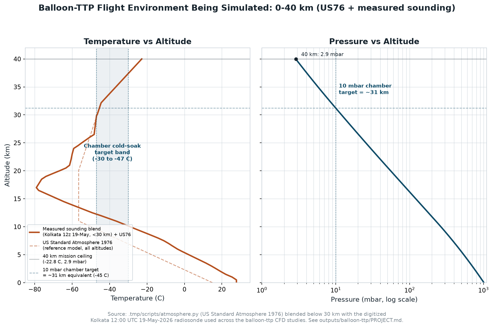
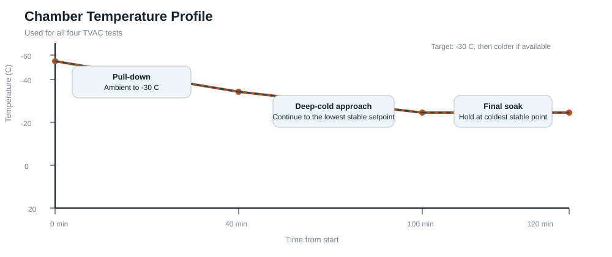

<!-- Test Procedure · Thermal Vacuum (TVAC) -->

# Envisys Tech TVAC Test Plan

**Jetson Payload with Copper Straps and Radiator Variants — balloon-ttp Project**

| | | | |
| --- | --- | --- | --- |
| **Document No.** | ENVISYS-TVAC-BALLOON-TTP-001 | **Revision** | B |
| **Status** | Released for Test | **Issue Date** | 2026-08-13 |
| **Project** | balloon-ttp | **Test Facility** | Envisys Tech TVAC chamber |
| **Prepared For** | Chamber technician and test lead, Envisys Tech | **Test Window** | 8 hours, single continuous session |
| **Prepared By** | balloon-ttp engineering team | **Distribution** | Test lead, chamber technician, payload engineering |
| **Classification** | Internal / Contractor-Confidential — not for external release | | |

## Table of Contents

1. Purpose and Scope
2. Applicable Documents and References
3. Definitions and Acronyms
4. Roles and Responsibilities
5. What Needs To Be Achieved
6. Flight Environment Being Simulated (0 to 40 km)
7. Simulation Reference — Case 1 Benchmark
8. Test Article and Cases
9. Required Instrumentation and Equipment
10. Safety Precautions
11. Chamber Profile
12. 8-Hour Execution Timeline
13. Test Procedure
14. Acceptance Criteria (Pass / Fail)
15. Data To Record
16. What Success Looks Like
17. Files and Figures Used
18. Revision History
19. Approval Signatures

## 1. Purpose and Scope

This document is the technician-facing test procedure for a single 8-hour Thermal Vacuum (TVAC) session at the Envisys Tech chamber, screening four hardware/power configurations of the balloon-ttp Jetson payload. It defines the objective, the environment being approximated, the exact chamber profile and timeline, the instrumentation required, safety precautions, acceptance criteria, and the data package expected at the end of the session.

**In scope:** one chamber profile (pull-down, deep-cold approach, final soak) executed four times back-to-back, with Jetson power (10 W / 30 W) and radiator count (single / dual) as the only variables between runs.

**Out of scope:** reproduction of the full multi-hour flight ascent/descent timeline; qualification-level environmental cycling; vibration, shock, or EMI testing; any configuration other than the four listed in Section 8. This is a screening test, not a qualification test.

<strong>Purpose:</strong> the payload's real mission is a balloon ascent from ground level to 40 km. An 8-hour chamber run cannot reproduce that timeline, so this plan asks the chamber to reproduce the <em>environment</em> instead — the cold, low-pressure air the payload sees on the way up — using a compressed pull-down-and-hold profile. Sections 6 and 7 exist specifically so the technician can see what altitude environment the chamber setpoints correspond to and what the simulations already predict for the strongest configuration, rather than treating -30 C / 10 mbar as an arbitrary target.

## 2. Applicable Documents and References

| Ref. | Document | Relevance |
| --- | --- | --- |
| [1] | `outputs/balloon-ttp/PROJECT.md` | Project scope record, hardware model, full CFD study log |
| [2] | `outputs/balloon-ttp/transient-0-40km/report/report.md` | 30 W dual-radiator ascent simulation (Case 1 benchmark, Section 7) |
| [3] | `outputs/balloon-ttp/transient-0-40km-dwell-60min/report/report.md` | 60-minute 40 km dwell continuation of [2] |
| [4] | `.tmp/scripts/atmosphere.py` | US76 + measured-sounding atmosphere model used to build Section 6 |
| [5] | `inputs/Graphs and other inputs/Temp profile 0-30km.jpeg` | Client-supplied reference sounding (Figure 0) |
| [6] | Envisys Tech TVAC chamber standard operating procedure (facility document, not attached) | Facility-specific interlocks, pump-down/vent SOP, and safety procedures — takes precedence over Section 10 of this plan wherever the two differ |

## 3. Definitions and Acronyms

| Term | Meaning |
| --- | --- |
| TVAC | Thermal Vacuum — a chamber that controls pressure and temperature together |
| TTP | Thermal Transfer Path — the twin copper-strap path from the Jetson cold plate to the external radiators |
| CHT / CFD | Conjugate Heat Transfer / Computational Fluid Dynamics — the simulation method behind Sections 6 and 7 |
| Case / Test 1-4 | One of the four power/radiator-count configurations defined in Section 8 |
| mbar | Millibar, 1 mbar = 100 Pa = 0.75 torr — the chamber's pressure unit in this plan |
| US76 | US Standard Atmosphere 1976 — reference model for temperature/pressure vs. altitude |
| DAQ | Data acquisition system / logger |

## 4. Roles and Responsibilities

| Role | Responsibility during this test |
| --- | --- |
| Chamber Technician / Operator | Executes the chamber profile (Section 11), operates chamber controls and interlocks per facility SOP, logs chamber pressure/temperature, calls an abort per Section 10 if triggered |
| Test Lead | Owns this document, confirms configuration between cases (Section 13.3), makes the go/no-go call on schedule compression (Section 12), is the point of contact for anomalies |
| Payload Engineer (on call) | Confirms payload power/radiator configuration before each case, owns the payload's documented thermal safe-operating limit referenced in Section 14, available to advise on anomalies |
| Data Reviewer | Receives the logged package after the session (Section 15-16), checks Case 1 against the Section 7 simulation benchmark, and reports back to the analysis team |

## 5. What Needs To Be Achieved

- Determine whether the dual-radiator configuration provides a meaningful thermal benefit over the single-radiator configuration.
- Verify the 10 W dual-radiator case as the lower-load reference point.
- Verify the 10 W single-radiator case as the reduced-hardware comparison point.
- Stress the 30 W single-radiator case as the main risk case.
- Capture enough chamber and payload data to support a clear hardware decision after the test, and check the CFD model against real hardware for the first time on this configuration.

## 6. Flight Environment Being Simulated (0 to 40 km)

The chart below is the actual 0-40 km temperature and pressure environment the payload experiences in flight, built from the same atmosphere model the project's CFD studies use as their boundary condition (US Standard Atmosphere 1976, blended below 30 km with a digitized real radiosonde profile for the flight location — see refs [1] and [4]). This is what "the cold/low-pressure region" in Section 11 is standing in for.

| Altitude | Ambient temperature | Ambient pressure | Note |
| --- | ---: | ---: | --- |
| 0 km (ground) | ~28 C | 1013 mbar | Test start / chamber at ambient |
| ~11 km | ~-36 C | 227 mbar | Coldest point in the lower atmosphere on the way up |
| ~20 km | ~-57 to -67 C | 55 mbar | Tropopause cold plateau — the coldest true air temperature the payload sees anywhere in the ascent |
| ~31 km | ~-45 C | **10 mbar** | Where the chamber's achievable pressure and the real atmosphere's temperature line up together |
| 40 km (mission ceiling) | ~-23 C | **2.9 mbar** | Actual end-of-flight condition — warmer but at much lower pressure than the chamber test reaches |

<strong>Read this before setting up the chamber:</strong> the chamber technician has reported it can reliably reach about 10 mbar within the 8-hour window. In the real atmosphere, 10 mbar occurs at roughly 31 km, where the true air temperature is about -45 C — almost exactly the chamber's "-40 C or lower" cold target in Section 11. So the requested profile (10 mbar, -40 to -47 C) is a good simultaneous match to ~31 km flight conditions. It is <em>not</em> a literal 40 km replica: true 40 km air is colder in pressure (2.9 mbar, about a third of the chamber's target vacuum) but warmer in temperature (-23 C) than the ~31 km condition the chamber profile actually reaches. The test is thermally conservative relative to 40 km, but not vacuum-representative of it.

If the chamber can be pushed toward 3-5 mbar on the final soak of Test 4 only, without threatening the 8-hour schedule, that would close the vacuum gap to the true 40 km condition on the single most demanding case. This is a stretch goal — do not let it break the common-profile comparison across Tests 1-3.

## 7. Simulation Reference — What We Expect to See (Case 1 Benchmark)

The project has already run a transient CFD simulation of the exact Case 1 configuration: 30 W, both radiators, a full ascent to 40 km (ref [2]), continued through a further 60-minute hold at 40 km (ref [3]). This is not a prediction of the chamber test result — a real ascent is far slower and less cold than the chamber's compressed profile — but it tells the technician what a healthy Jetson/radiator response looks like on this hardware, with real numbers to sanity-check the logged data against.

| Quantity | End of simulated ascent (40 km) | After 60 min simulated dwell at 40 km |
| --- | ---: | ---: |
| `jetson_module` | 71.3 C | 78.2 C |
| `interface_plate` (cold plate) | 72.1 C | 78.9 C |
| Radiator plates (max) | ~19.4 / 19.9 C | ~25.0 / 25.5 C |
| Heat rejected by radiators | ~24.2 W | ~26.3 W |
| Heat injected at the die | 30.1 W | 30.1 W |

Even after the 60-minute dwell, radiated heat (~26.3 W) had not caught up to injected heat (30.1 W) — the simulated assembly was still slowly warming, not yet at steady state. **A Jetson temperature that is still climbing at the end of a 2-hour chamber hold is consistent with this simulation, not necessarily a fault to chase.**

<strong>Coverage gap:</strong> no simulation exists yet for the 10 W cases or for either single-radiator case (Tests 2, 3, 4) — the single-radiator hardware has not been modelled in CFD at all. Those three tests generate new information for the team rather than checking a known answer; treat them accordingly and do not assume the Case 1 numbers above bound them.

## 8. Test Article and Cases

| Case | Hardware configuration | Jetson power | Why it matters |
| --- | --- | ---: | --- |
| 1 | Both radiators installed | 30 W | Highest load with the strongest thermal hardware — compare against Section 7's simulated benchmark |
| 2 | Both radiators installed | 10 W | Lower load baseline for the full-radiator build — no CFD reference exists |
| 3 | Single radiator installed | 10 W | Lower-stress check of the reduced-radiator build — no CFD reference exists |
| 4 | Single radiator installed | 30 W | Highest-stress and most important risk case — no CFD reference exists |

The recommended order is Case 1 -> Case 2 -> Case 3 -> Case 4. That sequence verifies the stronger configuration first — while the simulation benchmark from Section 7 is fresh for comparison — then moves to the more severe single-radiator cases later in the 8-hour window.

## 9. Required Instrumentation and Equipment

The channel list below states the measurement capability this test needs. It is a requirement, not a specific gauge/logger brand — use whatever calibrated facility equipment meets or exceeds these ranges and accuracies. Confirm all instrumentation is within current calibration before the session.

| Channel | Measurement | Sensor type | Location | Required range | Required accuracy | Min. sample rate |
| --- | --- | --- | --- | --- | --- | --- |
| P1 | Chamber pressure | Vacuum gauge (Pirani / capacitance manometer) | Chamber volume | 1000 to 1 mbar | ±5% of reading | 1 Hz |
| T1 | Chamber ambient / shroud temperature | Thermocouple (Type T or K) | Chamber wall or shroud, near payload | -60 to +30 C | ±1 C | 1 Hz |
| T2 | Jetson module temperature | Thermocouple (bonded) or onboard digital sensor | `jetson_module` case/die surface | -60 to +100 C | ±1 C | 1 Hz |
| T3 | Interface / cold-plate temperature | Thermocouple (bonded) | `interface_plate` | -60 to +100 C | ±1 C | 1 Hz |
| T4 | Radiator 1 temperature | Thermocouple (bonded) | `radiator_plate` | -80 to +50 C | ±1 C | 1 Hz |
| T5 | Radiator 2 temperature | Thermocouple (bonded) | `radiator_plate_2` — Cases 1 and 2 only (dual-radiator builds) | -80 to +50 C | ±1 C | 1 Hz |
| PWR1 | Jetson input power (set + readback) | Bench DC supply with current/voltage readback, or shunt | Payload power feed, outside chamber | 0 to 40 W (0-20 V / 0-4 A typical) | ±2% of reading | 1 Hz |
| DAQ | All channels above, time-synchronized | Multi-channel data logger | Outside chamber, feedthrough-connected | — | Common timebase across all channels | Log at 1 Hz min., report at 30-60 s per Section 15 |

Other equipment: vacuum-rated electrical feedthrough for payload power and sense leads, payload mounting fixture reproducing the flight thermal interface, spare thermocouples and bonding adhesive for a mid-session repair, stopwatch or synchronized clock for changeover timing.

## 10. Safety Precautions

This section is a summary for planning purposes. The facility's own TVAC standard operating procedure (ref [6]) governs actual chamber operation, interlocks, and emergency response — follow it wherever it differs from the notes below.

- **Vacuum system:** confirm chamber door/seal interlocks are satisfied before pump-down begins. Do not open the chamber until it has been fully vented and equalized to ambient.
- **Cold surfaces:** the chamber interior and payload hardware will be well below 0 C during and immediately after each hold. Allow warm-up/vent before handling fixtures during changeover; use cold-rated gloves.
- **Electrical — Paschen region:** the pump-down and vent transitions pass through roughly 1-100 mbar, the electrical-breakdown minimum for many gap/voltage combinations (Paschen minimum). Confirm the payload power feedthrough and connectors are rated for vacuum use before applying power in this pressure band.
- **Power control:** verify the payload power command can be set to 0 W from outside the chamber before each case starts, so power can be removed immediately without opening the chamber.
- **Changeover:** only touch the payload once the chamber has vented and any bonded thermocouples/fixtures have returned to a safe handling temperature.

<strong>Abort conditions — stop the test and secure payload power immediately if any of the following occur:</strong>
<ul>
<li>Loss of chamber vacuum or temperature control that cannot be corrected within a few minutes.</li>
<li>Any indication of payload thermal runaway (temperature rising well beyond the Section 7 benchmark range with no sign of leveling).</li>
<li>Loss of a required temperature channel (Section 9) with no quick fix — do not continue a case blind on Jetson or interface-plate temperature.</li>
<li>Any facility alarm, interlock trip, or condition flagged by ref [6] as an abort trigger.</li>
</ul>
After an abort: vent the chamber per facility SOP, record the abort time and cause in the test log, and contact the test lead before re-attempting the case.

## 11. Chamber Profile

Use the same profile for all four tests unless the chamber has a validated better equivalent. The operator should log the actual chamber behavior against the requested profile so the results can be compared later.

### 11.0 Client-Supplied Reference Profile

This is the temperature profile supplied in the inputs folder. It is a real measured sounding (0-31 km) — the same low-altitude data source used to build the 0-40 km reference chart in Section 6 — and is the reference the technician should use when setting up the chamber sequence.

The chamber run does not try to reproduce this entire flight profile exactly. Instead, it reproduces the important thermal intent of the supplied profile within the available 8-hour chamber window: a strong pull-down, a low-pressure hold, and enough dwell to compare the hardware configurations.

### 11.1 Pressure and Temperature Profiles

<figure>

<figcaption>Figure 1. Pressure target: quick pull-down to about 10 mbar in 30 to 40 minutes, then a stable hold near that level for the rest of the test. Per Section 6, 10 mbar is a ~31 km equivalent.</figcaption>
</figure>
<figure>

<figcaption>Figure 2. Temperature target: reach about -30 C during the first pull-down window, then continue to the coldest stable setpoint available (target -40 C or lower).</figcaption>
</figure>

| Stage | Time from start | Chamber pressure | Chamber temperature | Approx. real-altitude equivalent |
| --- | ---: | ---: | ---: | --- |
| 1. Pull-down | 0 to 40 min | Ramp to 10 mbar | Ramp to -30 C | Passing through ~7-11 km on temperature, ~31 km on pressure |
| 2. Deep-cold approach | 40 to 100 min | Hold near 10 mbar | Continue lowering, target -40 C or lower | ~31 km (pressure and temperature together) |
| 3. Final soak | 100 to 120 min | Hold near 10 mbar | Hold at deepest stable cold setpoint | ~31 km hold |

If the chamber cannot reliably reach -40 C, use the lowest stable temperature available and log the actual achieved value — this remains at or below the ~31 km-equivalent temperature, so it is still a valid, if slightly less severe, cold case. The key requirement is comparability: each case should see the same chamber environment, so temperature response differences come from the hardware setup and power level rather than a different thermal history.

## 12. 8-Hour Execution Timeline

The planned pacing is one case every two hours, including pull-down, cold soak, and a short changeover review. If the chamber pull-down is slower than expected, preserve the final case as the priority case and shorten earlier soaks if necessary.

| Window | Activity |
| --- | --- |
| 0:00 to 2:00 | Case 1: 30 W, both radiators |
| 2:00 to 2:10 | Changeover and log review |
| 2:10 to 4:10 | Case 2: 10 W, both radiators |
| 4:10 to 4:20 | Changeover and log review |
| 4:20 to 6:20 | Case 3: 10 W, single radiator |
| 6:20 to 6:30 | Changeover and log review |
| 6:30 to 8:00 | Case 4: 30 W, single radiator |

## 13. Test Procedure

### 13.1 Pre-Test Checklist

- Confirm the payload configuration matches Case 1.
- Verify the chamber instrumentation is ready and zeroed, and confirm calibration dates against Section 9.
- Confirm temperature and pressure logging is active on all channels, at or above the required sample rate.
- Check that the payload power command can be set to 30 W, 10 W, and 0 W on demand from outside the chamber.
- Confirm the chamber operator and test lead are both aware that the same profile will be repeated four times.
- Review the abort conditions in Section 10 with everyone present for the session.

### 13.2 During Each Test

1. Start from the agreed initial chamber condition.
2. Pull down toward 10 mbar and -30 C over the first 30 to 40 minutes.
3. Continue lowering the chamber temperature to the coldest stable setpoint available.
4. Hold that condition long enough to capture the Jetson thermal response.
5. For Case 1 only: watch for the Jetson/interface-plate temperature approaching the ~70-80 C simulated band from Section 7. It does not need to reach that band in a 2-hour hold — the simulation itself was still rising at that point — but a large deviation either way is worth flagging.
6. Record any anomalies, control adjustments, or deviations from the requested profile.
7. Apply the Section 10 abort conditions throughout — do not wait for the scheduled end of the hold if one is triggered.

### 13.3 Between Tests

- Set payload power to 0 W and confirm the chamber has vented per Section 10 before opening.
- Change only what is needed for the next case: Jetson power level or radiator configuration.
- Record the time required for the changeover.
- If the chamber profile must be shortened, keep the last 30 W single-radiator case as the priority run.

## 14. Acceptance Criteria (Pass / Fail)

These criteria judge whether each case produced a usable, comparable result — not whether the hardware itself "passes" a qualification limit, since this is a screening test. Record a clear pass/fail/marginal call against each row for every case.

| Criterion | Pass condition |
| --- | --- |
| Profile conformance — pressure | Chamber reaches ≤15 mbar within 45 minutes (10 min margin on the 40 min target) and holds within ±20% of the achieved setpoint through the final soak |
| Profile conformance — temperature | Chamber reaches ≤-25 C within 45 minutes and reaches its lowest stable setpoint (target ≤-40 C) before the final soak begins |
| Payload safe-operating limit | Jetson module temperature stays below the payload's documented maximum safe/throttle temperature at all times — **confirm this limit with the payload engineer (Section 4) before the session; it is not fixed by this document** |
| No anomalous shutdown | No unplanned loss of payload power, communication, or chamber control during the hold |
| Data completeness | All Section 9 channels logged continuously for the full case, with no gap longer than 5 minutes |
| Cross-case comparability | All four cases run under a chamber profile matching each other within the tolerances above, so a difference in payload response can be attributed to power/radiator count rather than chamber history |
| Case 1 simulation cross-check | Informational, not pass/fail: Jetson/interface-plate trend broadly consistent (same order of magnitude, still-rising character) with the Section 7 benchmark. A sharply different result is a data-quality flag for the analysis team, not a test failure |

## 15. Data To Record

- Chamber pressure versus time
- Chamber temperature versus time
- Jetson temperature versus time
- Radiator temperature versus time (both radiators for Cases 1-2, single radiator for Cases 3-4)
- Payload power level and start time
- End time for the run
- Any control notes during pull-down, soak, or changeover

Recommended reporting interval: 30 to 60 seconds, drawn down from the Section 9 channels' 1 Hz logging rate.

## 16. What Success Looks Like

The test campaign is successful if the technician returns with a clean comparison set for the four cases under one common chamber profile. The result should make it obvious whether the second radiator provides a meaningful thermal benefit, whether the 10 W cases stay comfortably controlled, whether the 30 W single-radiator case is acceptable or clearly risky, and whether the profile and log quality are good enough to support the next hardware decision.

Case 1 additionally succeeds if its logged Jetson/interface-plate trend is broadly consistent with the simulated 71-79 C, still-rising trend in Section 7 — a sharply different result (much hotter, much cooler, or a flat plateau reached quickly) is worth a specific note back to the analysis team, since it would suggest the CFD boundary conditions need revisiting before they're trusted for the untested configurations.

At minimum, the final package should allow the engineering team to compare the four cases directly without guessing about chamber history or changeover conditions. Any case that failed a Section 14 criterion, or was aborted per Section 10, should be flagged as such in the handover rather than silently reported alongside the clean runs.

## 17. Files and Figures Used

| Type | File |
| --- | --- |
| Source plan | [envisys-tvac-test-plan-jetson-radiators.md](../envisys-tvac-test-plan-jetson-radiators.md) |
| Technician figure sources | [diagrams/README.md](../diagrams/README.md) |
| Flight environment 0-40 km (temperature + pressure) | [diagrams/atmosphere_0_40km.png](../diagrams/atmosphere_0_40km.png) |
| Simulation reference, Case 1 benchmark | [diagrams/sim_reference_30W_dual_radiator_ascent.png](../diagrams/sim_reference_30W_dual_radiator_ascent.png) |
| Client-supplied temperature profile | [diagrams/temp_profile_0_30km.jpeg](../diagrams/temp_profile_0_30km.jpeg) |
| Pressure figure | [diagrams/chamber_pressure_profile.svg](../diagrams/chamber_pressure_profile.svg) |
| Temperature figure | [diagrams/chamber_temperature_profile.svg](../diagrams/chamber_temperature_profile.svg) |
| Execution timeline figure | [diagrams/test_sequence_timeline.svg](../diagrams/test_sequence_timeline.svg) |
| Simulation source studies | `outputs/balloon-ttp/transient-0-40km/report/report.md`, `outputs/balloon-ttp/transient-0-40km-dwell-60min/report/report.md` |

## 18. Revision History

| Rev | Date | Description |
| --- | --- | --- |
| A | 2026-08-12 | Initial technician-facing TVAC plan: four-case test matrix, chamber pull-down/soak profile, 8-hour timeline |
| B | 2026-08-13 | Added the 0-40 km flight-environment analysis and altitude-equivalence of the chamber profile (Section 6), added the CFD simulation benchmark for Case 1 (Section 7), and reformatted as a formal test procedure: document control, references, definitions, roles, required instrumentation, safety precautions and abort conditions, and pass/fail acceptance criteria (Sections 1-4, 9-10, 14) |

## Closing Note

This is a screening plan, not a full flight replication — Section 6 spells out exactly where the chamber's achievable profile sits relative to the true 0-40 km flight environment, so nobody reading the results mistakes a ~31 km-equivalent cold soak for a 40 km one. The chamber run should be treated as a controlled comparison exercise whose purpose is to validate the latest radiator and strap arrangement under consistent low-pressure, low-temperature conditions, and to give the team its first real-hardware check against the CFD model. The value of the test is in the repeatable comparison across the four cases, the quality of the recorded profiles, and — for Case 1 — how well the hardware tracks the simulation.

## 19. Approval Signatures

By signing below, each party confirms this procedure has been reviewed and is approved for execution as written, subject to the facility SOP referenced in Section 2.

| Prepared By — Test Lead | Reviewed By — Payload Engineering | Approved By — Chamber Facility |
| --- | --- | --- |
| Name / Signature / Date: __________________ | Name / Signature / Date: __________________ | Name / Signature / Date: __________________ |

---

*Generated for the balloon-ttp project. The PDF should be produced from `report.html` so the embedded figures stay intact.*
