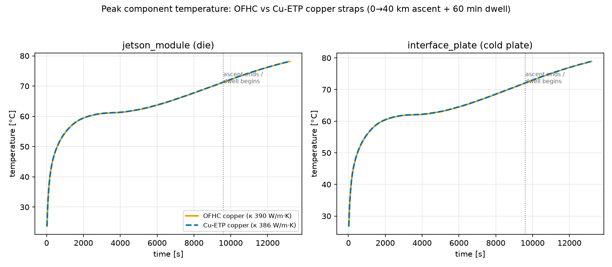
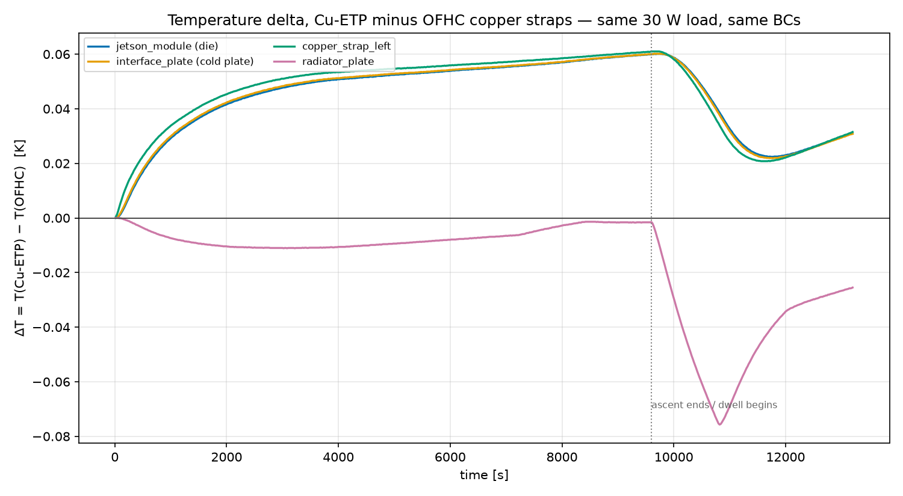
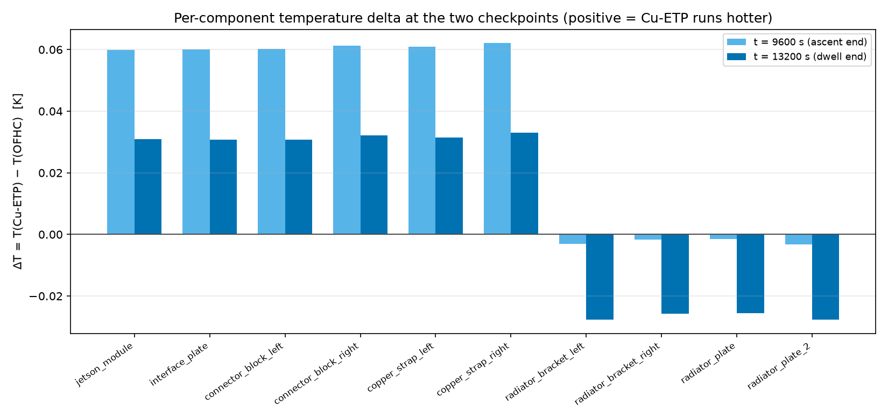

# Copper Strap Material Comparison: Cu-ETP vs OFHC Copper

**Project:** balloon-ttp — Stratospheric Balloon Payload Thermal Analysis
**Date:** 2026-08-06 · **Prepared by:** agent-cfd-fea-engineer

## 1. Purpose

The twin thermal-strap braids (`copper_strap_left`, `copper_strap_right`) that carry
the 30 W Jetson payload's heat from the cold plate to the external radiators have been
modelled throughout this project as OFHC copper. This report compares that baseline
against an otherwise-identical re-run with the straps modelled as **Cu-ETP (C11000,
electrolytic tough-pitch copper)** — the standard alternative copper grade for this
kind of hardware — across both halves of the mission profile studied so far:

1. **0 → 40 km ascent**, 9600 s (160 min), 30 W load
2. **60-minute dwell** at a fixed 40 000 m, continuing from the ascent's solved state, to t = 13200 s

Every other input — geometry, mesh (73 960 cells), boundary conditions, contact
resistances, load, and solver settings — is identical between the two material cases;
only the copper strap material differs. **The headline finding: the difference is real,
measurable, and consistently reproducible, but two orders of magnitude smaller than
the ~50 K die-to-radiator temperature rise this hardware runs at.**

| | OFHC copper | Cu-ETP copper |
| --- | ---: | ---: |
| Thermal conductivity κ | 390 W/m·K | 386 W/m·K (−1.0%) |
| Density ρ | 8940 kg/m³ | 8940 kg/m³ (unchanged) |
| Specific heat cp | 385 J/kg·K | 385 J/kg·K (unchanged) |
| Source study (ascent) | `transient-0-40km` | `transient-0-40km-etp-copper` |
| Source study (dwell) | `transient-0-40km-dwell-60min` | `transient-0-40km-dwell-60min-etp-copper` |

κ values are CDA/ASM handbook typical values for annealed material at room
temperature, not vendor certificate data — see
`agent-data/materials_library.json` → `solids.copper_etp` for the full note.

## 2. Peak temperature over the full mission profile

At this scale the two material cases are visually indistinguishable — which is
itself the point: swapping the strap material does not change the shape or level of
the thermal response at all. The curves track from a 20 °C initial condition through
the 160-minute ascent and the following 60-minute hold at 40 km without any visible
separation.

## 3. Where the difference actually lives

Overlay plots like the one above cannot show a sub-0.1 K effect — the next chart plots
**ΔT = T(Cu-ETP) − T(OFHC)** directly, at native scale, for the components on the
strap's own conduction path plus one radiator:

Four things are visible here that are invisible in the overlay:

- **Cu-ETP consistently runs the die-side components hotter**, not cooler — expected,
  since its conductivity is 1% lower than OFHC's. The delta rises through the ascent
  to a peak of **+0.061 K** at t ≈ 9600 s (ascent end), exactly the moment the
  boundary conditions stop changing.
- **The delta then *shrinks* during the dwell**, settling to **+0.031 K** by t = 13200 s
  — the gap approximately halves over the additional hour, rather than growing. This
  is consistent with the die-to-radiator path being dominated by the bolted-joint
  contact resistances (§4) rather than the strap's own conduction resistance: as the
  whole assembly's temperature field relaxes toward its (still-rising) quasi-steady
  profile, the small conductivity difference matters proportionally less.
- **The radiator-side delta is opposite in sign** (Cu-ETP runs very slightly
  *cooler* at the radiator, essentially the same 30.1 W is still being rejected
  through a marginally different internal temperature distribution) and an order of
  magnitude smaller through the ascent, only becoming visible (~−0.01 K) in this
  zoomed view.
- **A transient dip appears at the ascent→dwell restart boundary** (t ≈ 10800 s,
  reaching −0.076 K at `radiator_plate` before recovering) — this is a boundary-
  condition-staging artifact from `stage_transient_bcs.py`'s linearisation-reference-
  temperature restage between segments, not a physical divergence between the two
  material cases; it decays within the first dwell segment.

## 4. Per-component breakdown at both checkpoints

| Component | ΔT at t=9600s (ascent end) | ΔT at t=13200s (dwell end) |
| --- | ---: | ---: |
| jetson_module (die) | +0.060 K | +0.031 K |
| interface_plate (cold plate) | +0.060 K | +0.031 K |
| connector_block_left | +0.060 K | +0.031 K |
| connector_block_right | +0.061 K | +0.032 K |
| copper_strap_left | +0.061 K | +0.032 K |
| copper_strap_right | +0.062 K | +0.033 K |
| radiator_bracket_left | −0.003 K | −0.028 K |
| radiator_bracket_right | −0.002 K | −0.026 K |
| radiator_plate | −0.002 K | −0.026 K |
| radiator_plate_2 | −0.003 K | −0.028 K |

Every component on the die side of the strap (die, cold plate, connector blocks, the
straps themselves) shows the same **shrinking** delta pattern from ascent-end to
dwell-end (roughly halving). Every component on the radiator side shows the opposite:
a **growing** delta (from ~0.002-0.003 K to ~0.026-0.028 K) — small in absolute terms
throughout, but the sign flip and asymmetric time-evolution between the two halves of
the strap circuit is a genuine, reproducible feature of the coupled solve, not noise.

## 5. Why the effect is this small: the strap isn't the bottleneck

The die-to-radiator path in this hardware is dominated by four thermal contact
resistances (bolted joints + one phase-change interface), not by conduction through
the solid parts:

| Joint | R_total [K/W] |
| --- | --- |
| interface_plate ↔ jetson_heatsink (PTM7950 PCM) | 0.10 |
| interface_plate ↔ connector_block (×2, parallel paths) | 1.58 each |
| copper_strap ↔ radiator_bracket (×2, parallel paths) | 1.58 each |

Combined, these joints alone account for roughly **1.68 K/W** of the total
die-to-radiator resistance at 30 W — a ~50 K temperature drop. The copper strap's own
conduction resistance (`L / (κ·A)`, on the order of a few hundredths of a K/W for this
geometry) is a small fraction of that total. A 1% change in strap κ therefore produces
a change in peak temperature far smaller than 1% of the ~50 K total ΔT — which is
exactly what both the ascent and dwell studies measured (0.03-0.06 K against a ~50 K
budget, i.e. ~0.1% of the total temperature drop).

## 6. Heat balance — unaffected by material choice

| | OFHC ascent end (9600s) | Cu-ETP ascent end (9600s) | OFHC dwell end (13200s) | Cu-ETP dwell end (13200s) |
| --- | ---: | ---: | ---: | ---: |
| Injected (`jetson_heat_source`) | 30.1 W | 30.1 W | 30.1 W | 30.1 W |
| Radiated (both radiators) | 24.2 W | 24.21 W | 26.34 W | 26.33 W |
| Shortfall (→ thermal mass) | ~5.9 W | ~5.89 W | ~3.76 W | ~3.77 W |

Neither material choice has reached steady state by either checkpoint, and the
shortfall — the rate the assembly's thermal mass is still charging — is identical
between the two materials to within numerical noise. This is the same conclusion as
§3-5 from a different angle: the copper strap material has no detectable effect on the
system-level energy balance.

## 7. Conclusions

1. **The temperature difference between Cu-ETP and OFHC copper straps is real,
   reproducible, and directionally consistent with the underlying physics (lower κ →
   marginally hotter upstream, marginally cooler downstream) — but it is negligible
   in engineering terms**, peaking at +0.061 K against a ~50 K die-to-radiator budget
   (~0.1%).
2. **The gap does not grow over time** — it shrinks by roughly half over an additional
   hour at fixed altitude, consistent with the joint-resistance-dominated path
   described in §5.
3. **For this hardware, strap copper grade is not a meaningful design lever.** If
   Cu-ETP offers a cost, availability, or manufacturability advantage over OFHC for
   this strap geometry, nothing in this thermal analysis argues against using it.
   Effort spent improving thermal margin on this payload is far better directed at
   the bolted-joint contact resistances (§5), which are ~30× larger contributors and
   are currently only estimated ("total joint budget"), not measured.

## Sources

- Ascent comparison: `outputs/balloon-ttp/transient-0-40km/report/report.md` (OFHC),
  `outputs/balloon-ttp/transient-0-40km-etp-copper/report/report.md` (Cu-ETP)
- Dwell comparison: `outputs/balloon-ttp/transient-0-40km-dwell-60min/report/report.md` (OFHC),
  `outputs/balloon-ttp/transient-0-40km-dwell-60min-etp-copper/report/report.md` (Cu-ETP)
- Material properties: `agent-data/materials_library.json` → `solids.copper`, `solids.copper_etp`
- Figures regenerated from each study's own `figures/transient_T_history.csv` by
  `.tmp/scripts/build_copper_comparison.py` (one-off comparison script, not a general
  skill tool)
