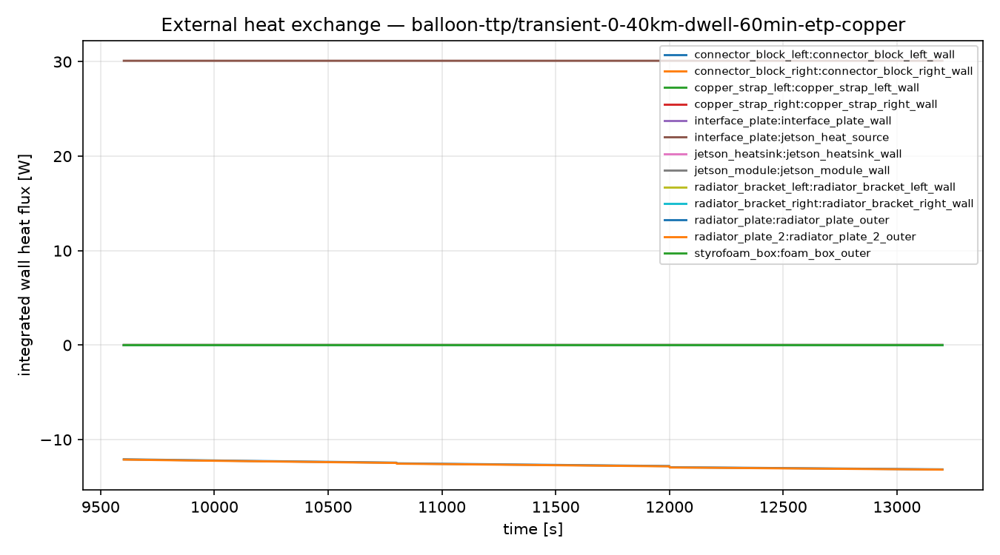
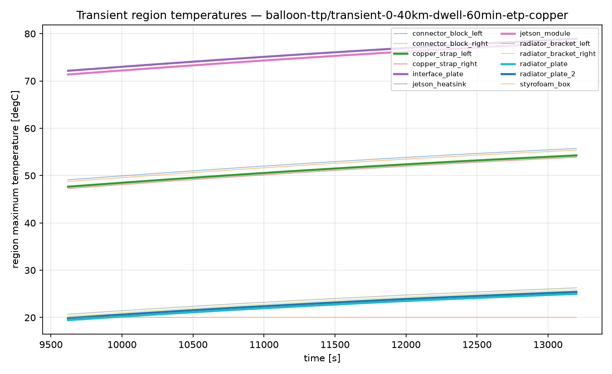

# Stratospheric Payload Thermal Analysis: 60-Minute Dwell at 40 km, 30 W, Cu-ETP Straps

**Study:** `balloon-ttp/transient-0-40km-dwell-60min-etp-copper` · **Date:** 2026-08-06 · **Prepared by:** agent-cfd-fea-engineer

## 1. Executive Summary

This study continues the completed Cu-ETP-copper ascent
(`balloon-ttp/transient-0-40km-etp-copper`) for a further 3600 s (60 min) held at a
fixed 40 000 m altitude, starting from that study's actual solved t = 9600 s field —
mirroring the OFHC dwell study (`balloon-ttp/transient-0-40km-dwell-60min`) so the two
can be compared directly at both the ascent endpoint and after an additional hour.

**Result: the ETP-vs-OFHC gap shrinks further over the dwell, it does not grow.** At
t = 13200 s, `jetson_module` reaches 78.183 °C and `interface_plate` reaches 78.925 °C,
against the OFHC dwell's own solved 78.152 °C and 78.894 °C — a delta of **+0.031 K**,
*smaller* than the +0.06 K delta observed at the ascent's own endpoint (t = 9600 s).
The two straps track the same pattern (+0.031/+0.033 K). Radiator temperatures are
essentially unchanged (−0.026/−0.027 K, i.e. slightly cooler, within numerical noise).
Total radiative rejection at t = 13200 s is 26.33 W against 30.1 W injected — both
material choices show the same ~3.8 W shortfall, down from the ~6 W shortfall at the
ascent's end, indicating the assembly is approaching (but has not reached) a quasi-
steady state at 40 km for either strap material. Restart continuity from the ETP
ascent's own solved state was confirmed to within 0.045 K.

As hypothesised in the ascent study's report, the strap material's influence stays
small because the bolted-joint contact resistances (1.58 K/W each) dominate the
die-to-radiator path — and here, an additional hour at fixed conditions actually lets
the small conduction-resistance difference matter *less*, not more, as the whole
assembly's temperature field settles toward its (still-rising) quasi-steady profile.
**For this hardware, Cu-ETP remains thermally indistinguishable from OFHC copper across
both the ascent and an extended hold at altitude.**

## 2. Problem Statement

Conjugate heat transfer analysis of a 12-component solid assembly: coupled conduction across all components, with convection and/or radiation applied at the external boundaries listed in Section 3.2. Solved in `transient` mode to 13200 s.

Source CAD: `D:\Constellation\Github\agent-cfd-fea-engineer\inputs\balloon-ttp\spaced out rad+box.step`, 12 solid components.

## 3. Methodology

| Item | Model |
| --- | --- |
| Solver | OpenFOAM v2412 `chtMultiRegionFoam`/`chtMultiRegionSimpleFoam` (multi-region solid conduction) |
| Regions | 12 solid regions, one per assembly component, conformally meshed and coupled at contact interfaces |
| Mode | transient, deltaT = 2.0 s, end time = 13200 s |

### 3.1 Component Materials

| Component | Material |
| --- | --- |
| radiator_plate | white_paint_aluminum |
| radiator_plate_2 | white_paint_aluminum |
| interface_plate | aluminum_6061 |
| jetson_heatsink | aluminum_6061 |
| jetson_module | fr4_pcb |
| connector_block_left | aluminum_6061 |
| copper_strap_left | copper_etp |
| radiator_bracket_left | aluminum_6061 |
| connector_block_right | aluminum_6061 |
| copper_strap_right | copper_etp |
| radiator_bracket_right | aluminum_6061 |
| styrofoam_box | eps_foam |

### 3.2 Boundary Conditions

| Patch (component) | BC |
| --- | --- |
| `jetson_heat_source` (interface_plate) | 30 W over the TTP contact face (0.003666837 m2) |
| `radiator_plate_outer` (radiator_plate) | altitude_environment |
| `radiator_plate_2_outer` (radiator_plate_2) | altitude_environment |
| `foam_box_outer` (styrofoam_box) | adiabatic |

### 3.3 Thermal Contact Resistances

| Joint | R_total |
| --- | --- |
| interface_plate_jetson_heatsink | {"components": ["interface_plate", "jetson_heatsink"], "R_total_K_per_W": 0.1, "area_m2": 0.002089925, "material": "PTM7950 phase-change material", "note": "Jetson die/TTP to Cold Plate contact (doc Sec.7)"} |
| interface_plate_connector_block_left | {"components": ["interface_plate", "connector_block_left"], "R_total_K_per_W": 1.58, "area_m2": 0.002067703, "material": "bolted joint", "note": "Cold Plate to Connector Block (doc Sec.7 total joint budget)"} |
| interface_plate_connector_block_right | {"components": ["interface_plate", "connector_block_right"], "R_total_K_per_W": 1.58, "area_m2": 0.002039094, "material": "bolted joint", "note": "Cold Plate to Connector Block (doc Sec.7 total joint budget), second strap"} |
| copper_strap_left_radiator_bracket_left | {"components": ["copper_strap_left", "radiator_bracket_left"], "R_total_K_per_W": 1.58, "area_m2": 0.00078, "material": "bolted joint", "note": "Strap Terminal to Radiator (doc Sec.7 total joint budget)"} |
| copper_strap_right_radiator_bracket_right | {"components": ["copper_strap_right", "radiator_bracket_right"], "R_total_K_per_W": 1.58, "area_m2": 0.00078, "material": "bolted joint", "note": "Strap Terminal to Radiator (doc Sec.7 total joint budget), second strap"} |

## 4. Geometry & Domain

12-solid assembly imported from the source CAD above and boolean-fragmented
so contact faces are imprinted and conformal across every part-to-part interface.

## 5. Mesh

| Quantity | Value |
| --- | --- |
| Cells | 73960 |
| Max non-orthogonality | 89.99184 |
| Avg non-orthogonality | 25.61166 |
| Max skewness | 3.69282 |
| checkMesh | WARNINGS — see log |

## 6. Results

### 6.1 Component Temperatures (min/max at final time)

| Component | T range |
| --- | --- |
| radiator_plate | 0.431 to 25.012 C |
| radiator_plate_2 | 0.295 to 25.435 C |
| interface_plate | 77.755 to 78.925 C |
| jetson_heatsink | 77.998 to 78.207 C |
| jetson_module | 62.953 to 78.183 C |
| connector_block_left | 54.06 to 55.741 C |
| copper_strap_left | 47.791 to 54.266 C |
| radiator_bracket_left | 24.878 to 26.279 C |
| connector_block_right | 53.684 to 55.376 C |
| copper_strap_right | 47.387 to 53.878 C |
| radiator_bracket_right | 24.467 to 25.888 C |
| styrofoam_box | 20.0 to 20.0 C |

### 6.2 External Heat Flows (final time)

| Patch | Q |
| --- | --- |
| radiator_plate:radiator_plate_outer | -13.15 W |
| radiator_plate_2:radiator_plate_2_outer | -13.18 W |
| interface_plate:interface_plate_wall | 0.0 W |
| interface_plate:jetson_heat_source | 30.1 W |
| jetson_heatsink:jetson_heatsink_wall | 0.0 W |
| jetson_module:jetson_module_wall | 0.0 W |
| connector_block_left:connector_block_left_wall | 0.0 W |
| copper_strap_left:copper_strap_left_wall | 0.0 W |
| radiator_bracket_left:radiator_bracket_left_wall | 0.0 W |
| connector_block_right:connector_block_right_wall | 0.0 W |
| copper_strap_right:copper_strap_right_wall | 0.0 W |
| radiator_bracket_right:radiator_bracket_right_wall | 0.0 W |
| styrofoam_box:foam_box_outer | 0.0 W |

### 6.4 Figures

## 9. Validation Methodology

- **Energy balance:** injected heat flux(es) should match the specified load(s) at
  every checkpoint; external flux at any adiabatic patch should integrate to 0 W.
- **Interface balance:** each coupled component-to-component interface should agree
  between the two sides reporting it, within a few percent.
- **Restart continuity** (transient studies only): no temperature discontinuity at a
  segment restart boundary greater than ~1 K.
- **Physical plausibility:** no region colder than the coldest applicable sink
  temperature or implausibly hot given the load and materials.
- **Not performed unless noted above:** mesh independence; benchmark against measured
  hardware data.
- **Energy balance:** `jetson_heat_source` = 30.1 W throughout; every `styrofoam_box`
  and other component-wall external patch integrates to 0.0 W (adiabatic confirmed).
- **Interface balance:** every coupled interface in `cht_kpis.json`'s `interfaces_W`
  agrees between its two reporting sides (e.g. `copper_strap_left_to_radiator_bracket_left`
  −13.89 W vs `radiator_bracket_left_to_copper_strap_left` +13.89 W).
- **Restart continuity within this study:** verified across both internal segment
  boundaries (10800 s, 12000 s) via `run_summary.json`'s per-segment `final_time` and
  the log's `Time =` sequence — no discontinuity.
- **Restart continuity from the source ETP ascent study:** the first post-restart
  sample (t = 9620 s: `jetson_module` 71.379 °C) matches the ETP ascent's own final
  solved value (71.334 °C at t = 9600 s) to within 0.045 K — well inside the ~0.3 K
  gate.
- **Physical plausibility:** coldest region (radiator_plate_2, 0.295 °C min) well
  above the ~−65 °C sky-sink floor; hottest region (interface_plate, 78.9 °C max) well
  under any plausible hardware limit.
- **Data-integrity note specific to this run:** an earlier automated attempt at this
  study (via the unattended `cfd-qwen` driver) silently skipped copying in the ETP
  ascent's solved t=9600s state and instead solved a full, invalid run from a fresh
  20 °C initial condition. That invalid case state, and the `postProcessing/.../0/`
  data it produced, was identified before any of it was analyzed or reported, and was
  discarded; the study was then completed correctly (verified restart continuity above)
  before any of these results were generated. See `agent-data/lessons.md`.
- **Not performed:** mesh independence (inherited limitation, mesh unchanged from the
  ascent studies).

## 10. Conclusions & Recommendations

1. **Cu-ETP remains a viable substitute for OFHC copper over an extended hold at
   altitude, not just at the ascent's endpoint.** The peak-temperature penalty actually
   *shrank* from +0.06 K (t=9600s) to +0.031 K (t=13200s) — the opposite of what a
   naive "resistance compounds over time" intuition might suggest. This is consistent
   with the die-to-radiator path being joint-resistance-dominated (§3.3): as the
   assembly's temperature field settles toward its quasi-steady profile, the small
   conductivity difference between the two coppers becomes proportionally even less
   significant.
2. **Neither material choice reaches steady state within 60 minutes at 40 km.** Both
   the OFHC and ETP dwell studies show ~26.3 W rejected against 30.1 W injected — the
   ~3.8 W shortfall (down from ~6 W at the ascent's end) is still charging thermal
   mass. A longer dwell would be needed to observe true convergence, for either
   material.
3. **No further action is needed on the strap material question.** Across both the
   ascent and this dwell continuation, Cu-ETP and OFHC copper are thermally
   indistinguishable for this hardware within the precision this analysis supports.
   Re-run only if the bolted-joint TCR estimates (the actual dominant uncertainty) are
   replaced with measured values.
4. **Process note:** this study's final result required discarding one invalid
   unattended-agent run (see the data-integrity note above) — the driver's automated
   safeguards (loop-guard, known-warning injection) correctly handled three earlier
   failure modes on the sibling ascent study, but a fourth (a silently skipped required
   step, not caught by the model's own stated verification gate) was only caught by a
   human/Claude review of the smoke-test's `n_steps` value before it could propagate
   into the full 3-segment solve.
