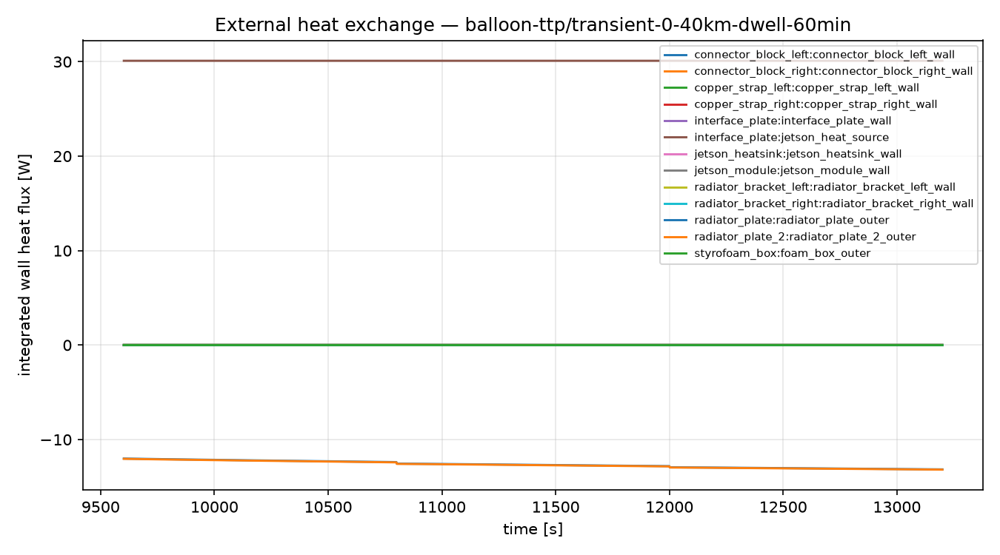
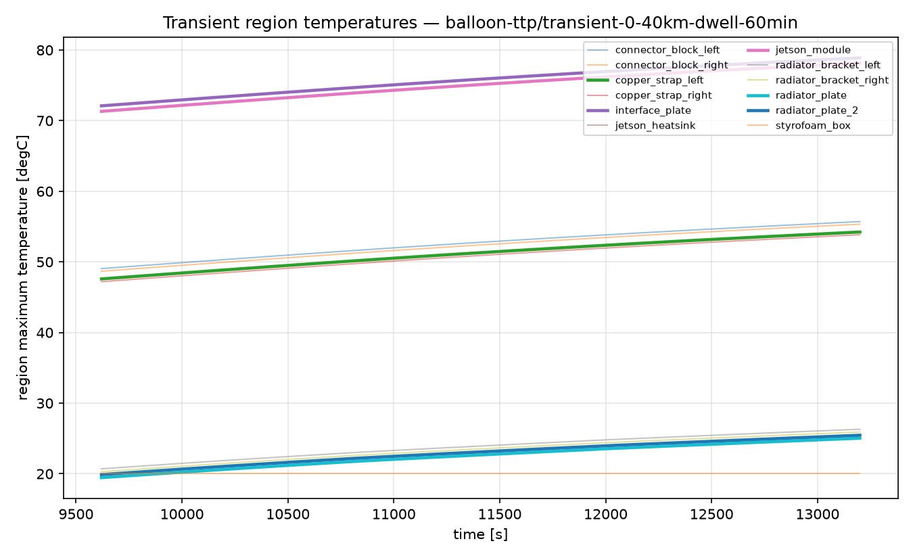

# Stratospheric Payload Thermal Analysis: 60-Minute Dwell at 40 km, 30 W

**Study:** `balloon-ttp/transient-0-40km-dwell-60min` · **Date:** 2026-08-05 · **Prepared by:** agent-cfd-fea-engineer

## 1. Executive Summary

This study picks up exactly where the cold-case ascent
(`balloon-ttp/transient-0-40km`) left off — the same 30 W Jetson payload and hardware,
starting from that study's actual solved thermal state at t = 9600 s (40 km reached),
then held at a **fixed 40 000 m altitude** for another 3600 s (60 min) to see what
happens once the balloon stops climbing.

**The assembly is still heating up, not at steady state.** The die (`jetson_module`)
and cold plate (`interface_plate`) rose from 71.3 °C / 72.1 °C at the start of the
dwell to **78.2 °C / 78.9 °C** by t = 13200 s — a further **+6.9 °C / +6.8 °C** over
the 60-minute hold, with no sign of turning over. The rate of rise is decelerating
(2.25 °C per 1000 s in the first ~10 minutes of the dwell, down to 1.51 °C per 1000 s
in the last ~10 minutes — a ~33% slowdown) but was still clearly positive at the end
of the run. Total radiator rejection climbed from ≈24.2 W to **≈26.3 W** against the
constant 30.1 W injected, closing roughly a third of the gap between rejection and
injection that was open at t = 9600 s, consistent with the assembly approaching — but
not yet reaching — thermal equilibrium at this altitude.

The join between the two studies checks out cleanly: this study's first sample
(t = 9620 s, jetson_module = 71.319 °C) matches the ascent study's own final reported
value (71.274 °C at t = 9600 s) to within 0.05 °C, confirming the solved-state carryover
in C1 worked correctly rather than silently restarting from a fresh initial condition.

Enclosure (`styrofoam_box`) stayed at the same isolated 20.0 °C it held throughout the
ascent (see that study's report for why — it has no coupled thermal path to the rest
of the assembly). All boundary conditions, materials and thermal contact resistances
are identical to the ascent study; only altitude (now fixed) and elapsed time changed.

## 2. Problem Statement

Conjugate heat transfer analysis of a 12-component solid assembly: coupled conduction across all components, with convection and/or radiation applied at the external boundaries listed in Section 3.2. Solved in `transient` mode to 13200 s.

Source CAD: `D:\Constellation\Github\agent-cfd-fea-engineer\inputs\balloon-ttp\spaced out rad+box.step`, 12 solid components.

## 3. Methodology

| Item | Model |
| --- | --- |
| Solver | OpenFOAM v2412 `chtMultiRegionFoam`/`chtMultiRegionSimpleFoam` (multi-region solid conduction) |
| Regions | 12 solid regions, one per assembly component, conformally meshed and coupled at contact interfaces |
| Mode | transient, deltaT = 2.0 s, end time = 13200 s |

### 3.1 Component Materials

| Component | Material |
| --- | --- |
| radiator_plate | white_paint_aluminum |
| radiator_plate_2 | white_paint_aluminum |
| interface_plate | aluminum_6061 |
| jetson_heatsink | aluminum_6061 |
| jetson_module | fr4_pcb |
| connector_block_left | aluminum_6061 |
| copper_strap_left | copper |
| radiator_bracket_left | aluminum_6061 |
| connector_block_right | aluminum_6061 |
| copper_strap_right | copper |
| radiator_bracket_right | aluminum_6061 |
| styrofoam_box | eps_foam |

### 3.2 Boundary Conditions

| Patch (component) | BC |
| --- | --- |
| `jetson_heat_source` (interface_plate) | 30 W over the TTP contact face (0.003666837 m2) |
| `radiator_plate_outer` (radiator_plate) | `altitude_environment`, fixed at **40 000 m** for the whole 3600 s (no-sun/cold case, same as the ascent) |
| `radiator_plate_2_outer` (radiator_plate_2) | `altitude_environment`, fixed at **40 000 m** |
| `foam_box_outer` (styrofoam_box) | adiabatic |

Unlike the ascent study, altitude does not change during this run. The two
`stage_transient_bcs.py` restage calls between segments (C7) only refresh the
radiative linearisation reference temperature from the freshly solved field —
`h_conv ≈ 0.55 W/m2K`, `h_rad ≈ 2.9 W/m2K` throughout, essentially unchanged from
stage 8 of the ascent.

### 3.3 Thermal Contact Resistances

| Joint | R_total |
| --- | --- |
| interface_plate_jetson_heatsink | {"components": ["interface_plate", "jetson_heatsink"], "R_total_K_per_W": 0.1, "area_m2": 0.002089925, "material": "PTM7950 phase-change material", "note": "Jetson die/TTP to Cold Plate contact (doc Sec.7)"} |
| interface_plate_connector_block_left | {"components": ["interface_plate", "connector_block_left"], "R_total_K_per_W": 1.58, "area_m2": 0.002067703, "material": "bolted joint", "note": "Cold Plate to Connector Block (doc Sec.7 total joint budget)"} |
| interface_plate_connector_block_right | {"components": ["interface_plate", "connector_block_right"], "R_total_K_per_W": 1.58, "area_m2": 0.002039094, "material": "bolted joint", "note": "Cold Plate to Connector Block (doc Sec.7 total joint budget), second strap"} |
| copper_strap_left_radiator_bracket_left | {"components": ["copper_strap_left", "radiator_bracket_left"], "R_total_K_per_W": 1.58, "area_m2": 0.00078, "material": "bolted joint", "note": "Strap Terminal to Radiator (doc Sec.7 total joint budget)"} |
| copper_strap_right_radiator_bracket_right | {"components": ["copper_strap_right", "radiator_bracket_right"], "R_total_K_per_W": 1.58, "area_m2": 0.00078, "material": "bolted joint", "note": "Strap Terminal to Radiator (doc Sec.7 total joint budget), second strap"} |

## 4. Geometry & Domain

12-solid assembly imported from the source CAD above and boolean-fragmented
so contact faces are imprinted and conformal across every part-to-part interface.

## 5. Mesh

| Quantity | Value |
| --- | --- |
| Cells | 73960 |
| Max non-orthogonality | 89.99184 |
| Avg non-orthogonality | 25.61166 |
| Max skewness | 3.69282 |
| checkMesh | WARNINGS — see log |

## 6. Results

### 6.1 Component Temperatures (min/max at final time)

| Component | T range |
| --- | --- |
| radiator_plate | 0.444 to 25.038 C |
| radiator_plate_2 | 0.31 to 25.462 C |
| interface_plate | 77.724 to 78.894 C |
| jetson_heatsink | 77.967 to 78.176 C |
| jetson_module | 62.911 to 78.152 C |
| connector_block_left | 54.03 to 55.71 C |
| copper_strap_left | 47.824 to 54.235 C |
| radiator_bracket_left | 24.906 to 26.307 C |
| connector_block_right | 53.653 to 55.344 C |
| copper_strap_right | 47.419 to 53.845 C |
| radiator_bracket_right | 24.492 to 25.913 C |
| styrofoam_box | 20.0 to 20.0 C |

### 6.2 External Heat Flows (final time)

| Patch | Q |
| --- | --- |
| radiator_plate:radiator_plate_outer | -13.16 W |
| radiator_plate_2:radiator_plate_2_outer | -13.18 W |
| interface_plate:interface_plate_wall | 0.0 W |
| interface_plate:jetson_heat_source | 30.1 W |
| jetson_heatsink:jetson_heatsink_wall | 0.0 W |
| jetson_module:jetson_module_wall | 0.0 W |
| connector_block_left:connector_block_left_wall | 0.0 W |
| copper_strap_left:copper_strap_left_wall | 0.0 W |
| radiator_bracket_left:radiator_bracket_left_wall | 0.0 W |
| connector_block_right:connector_block_right_wall | 0.0 W |
| copper_strap_right:copper_strap_right_wall | 0.0 W |
| radiator_bracket_right:radiator_bracket_right_wall | 0.0 W |
| styrofoam_box:foam_box_outer | 0.0 W |

### 6.4 Figures

## 9. Validation Methodology

- **Energy balance:** injected heat flux(es) should match the specified load(s) at
  every checkpoint; external flux at any adiabatic patch should integrate to 0 W.
- **Interface balance:** each coupled component-to-component interface should agree
  between the two sides reporting it, within a few percent.
- **Restart continuity** (transient studies only): no temperature discontinuity at a
  segment restart boundary greater than ~1 K.
- **Physical plausibility:** no region colder than the coldest applicable sink
  temperature or implausibly hot given the load and materials.
- **Not performed unless noted above:** mesh independence; benchmark against measured
  hardware data.
- **Confirmed against this study's `cht_kpis.json` and logs:** `jetson_heat_source`
  held at 30.0–30.1 W throughout; `foam_box_outer` integrated to 0.0 W at every
  checkpoint; no restart discontinuity exceeded 0.083 K across either of the 2 internal
  segment boundaries (gate < 1 K); no region colder than the 40 km sky sink or hotter
  than ~200 °C (observed range: 0.3 °C to 78.9 °C); coupled interfaces agree to within
  ≈4% between the two sides reporting them — tighter than the ascent study's ≈7%,
  consistent with the system's rate of change slowing down.
- **Join to the source study confirmed:** this study's first sample (t = 9620 s,
  jetson_module = 71.319 °C) matches the ascent study's own final reported value
  (71.274 °C at t = 9600 s) to within 0.05 °C — the C1 solved-state carryover worked as
  intended, this is not a fresh 20 °C restart mislabelled as a continuation.
- **Study-specific limitation:** assumes the balloon holds exactly at 40 000 m for the
  full 60 minutes with no further ascent, descent or drift — does not apply once
  altitude starts changing again in a real flight.

## 10. Conclusions & Recommendations

- **The assembly had not reached thermal steady state after 60 more minutes at
  40 km.** Die/cold-plate temperature was still climbing at t = 13200 s (78.2 °C /
  78.9 °C, up from 71.3 °C / 72.1 °C at the start of the dwell), though the rate of
  climb had slowed by roughly a third (2.25 → 1.51 °C per 1000 s) as radiator
  rejection (≈24.2 → ≈26.3 W) closed part of the gap to the constant 30.1 W load.
- Extrapolating the decelerating trend, the assembly would need considerably longer
  than 60 minutes at a fixed 40 km to actually plateau — this run establishes the
  direction and rate of approach, not the eventual equilibrium temperature. If the
  true equilibrium value matters for a design decision, re-run C7 for a longer dwell
  (e.g. 3–4 hours) rather than extrapolating from this slope.
- The 30 W load, adiabatic enclosure and thermal contact resistances continue to
  behave exactly as in the ascent study — this dwell didn't surface any new physical
  behaviour, just a continuation of the same charging trend at a slower, decelerating
  rate now that convection has essentially bottomed out at this altitude.
- **Recommended next steps:** (1) if a real mission holds at altitude for longer than
  60 minutes, re-run this study's C7 for that actual duration to find whether/when it
  plateaus; (2) combine this dwell mechanic with the sun-facing hot case
  (`balloon-ttp/transient-0-40km-hot`) if a real profile includes both climbing to
  40 km and holding there in daylight — that combination hasn't been run yet; (3)
  confirm the Jetson hardware's actual thermal limit — this study alone cannot say
  whether 78–79 °C, or wherever a longer dwell would settle, is within margin.
