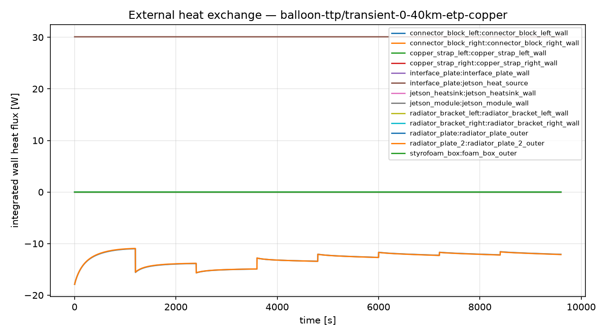
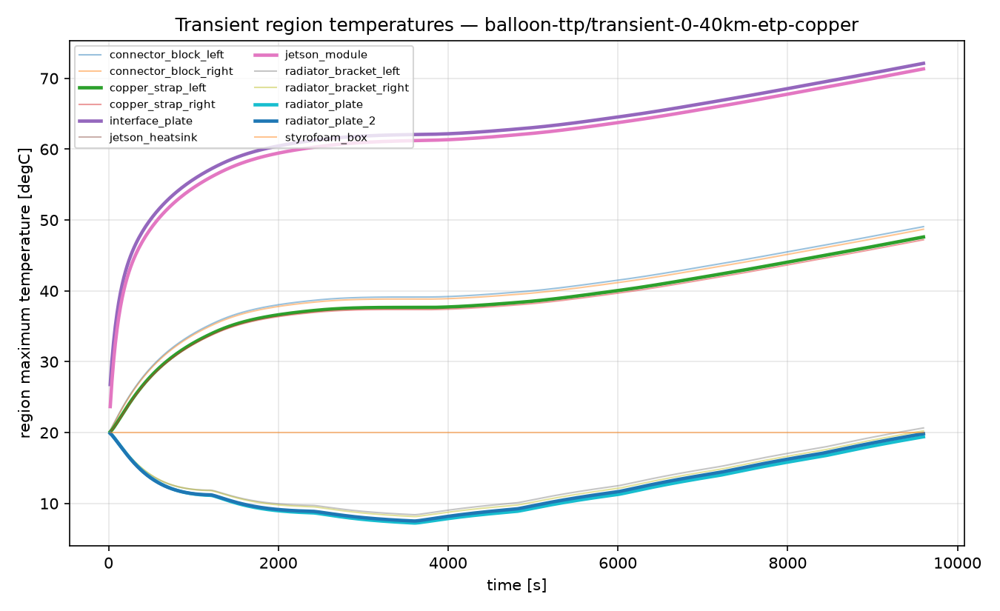

# Stratospheric Payload Transient Thermal Analysis: 0-40 km, 160 min, 30 W, Cu-ETP Straps

**Study:** `balloon-ttp/transient-0-40km-etp-copper` · **Date:** 2026-08-06 · **Prepared by:** agent-cfd-fea-engineer

## 1. Executive Summary

This study re-solves the completed 0→40 km / 160-minute / 30 W ascent transient
(`balloon-ttp/transient-0-40km`) with the twin thermal-strap braids changed from
OFHC copper (κ 390 W/m·K) to **Cu-ETP / C11000 electrolytic tough-pitch copper**
(κ 386 W/m·K, ρ 8940 kg/m³, cp 385 J/kg·K — new `copper_etp` library entry, CDA/ASM
handbook typical values for annealed material). Every other input — geometry, mesh
(73 960 cells, identical to the baseline), boundary conditions, contact resistances,
30 W load, and solver settings — is unchanged.

**Result: the material swap makes essentially no difference.** At t = 9600 s (40 km),
`jetson_module` reaches 71.334 °C and `interface_plate` reaches 72.115 °C, against the
OFHC baseline's own solved 71.274 °C and 72.055 °C — a delta of **+0.06 K**, i.e. ETP
copper runs marginally *hotter*, consistent with its ~1% lower conductivity. The two
copper straps themselves are 47.6 °C / 47.2 °C (ETP) vs 47.55 °C / 47.15 °C (OFHC),
also +0.06 K. Radiator temperatures are unchanged to three significant figures
(19.41 °C / 19.85 °C, vs 19.41 °C / 19.85 °C baseline — differences under 0.01 K).
Total radiative rejection at t = 9600 s is 24.21 W against 30.1 W injected (baseline:
24.2 W / 30.1 W) — the ~6 W shortfall is still going into thermal mass, i.e. the
assembly has **not** reached steady state at either material choice, matching the
baseline's own finding.

This ~0.06 K delta is consistent with the die-to-radiator path being dominated by the
bolted-joint contact resistances (1.58 K/W per joint, ≫ the strap's own conduction
resistance) rather than the strap material itself — see §3.3 and the discussion below.
For this hardware, **strap copper grade (OFHC vs Cu-ETP) is not a meaningful lever on
peak payload temperature**; joint quality/torque and the die-side TCR (0.10 K/W PTM7950
interface) dominate instead. All assumptions carried over from the baseline apply
unchanged: constant 4.1667 m/s assumed ascent rate, `altitude_environment` (US76) BC
from ground level, adiabatic enclosure, no mesh independence study, and the known CAD
sliver-face `checkMesh` warning (solved via `disable_fpe_trap`, not a mesh fix).

## 2. Problem Statement

Conjugate heat transfer analysis of a 12-component solid assembly: coupled conduction across all components, with convection and/or radiation applied at the external boundaries listed in Section 3.2. Solved in `transient` mode to 9600 s.

Source CAD: `D:\Constellation\Github\agent-cfd-fea-engineer\inputs\balloon-ttp\spaced out rad+box.step`, 12 solid components.

## 3. Methodology

| Item | Model |
| --- | --- |
| Solver | OpenFOAM v2412 `chtMultiRegionFoam`/`chtMultiRegionSimpleFoam` (multi-region solid conduction) |
| Regions | 12 solid regions, one per assembly component, conformally meshed and coupled at contact interfaces |
| Mode | transient, deltaT = 2.0 s, end time = 9600 s |

### 3.1 Component Materials

| Component | Material |
| --- | --- |
| radiator_plate | white_paint_aluminum |
| radiator_plate_2 | white_paint_aluminum |
| interface_plate | aluminum_6061 |
| jetson_heatsink | aluminum_6061 |
| jetson_module | fr4_pcb |
| connector_block_left | aluminum_6061 |
| copper_strap_left | copper_etp |
| radiator_bracket_left | aluminum_6061 |
| connector_block_right | aluminum_6061 |
| copper_strap_right | copper_etp |
| radiator_bracket_right | aluminum_6061 |
| styrofoam_box | eps_foam |

### 3.2 Boundary Conditions

| Patch (component) | BC |
| --- | --- |
| `jetson_heat_source` (interface_plate) | 30 W over the TTP contact face (0.003666837 m2) |
| `radiator_plate_outer` (radiator_plate) | altitude_environment |
| `radiator_plate_2_outer` (radiator_plate_2) | altitude_environment |
| `foam_box_outer` (styrofoam_box) | adiabatic |

### 3.3 Thermal Contact Resistances

| Joint | R_total |
| --- | --- |
| interface_plate_jetson_heatsink | {"components": ["interface_plate", "jetson_heatsink"], "R_total_K_per_W": 0.1, "area_m2": 0.002089925, "material": "PTM7950 phase-change material", "note": "Jetson die/TTP to Cold Plate contact (doc Sec.7)"} |
| interface_plate_connector_block_left | {"components": ["interface_plate", "connector_block_left"], "R_total_K_per_W": 1.58, "area_m2": 0.002067703, "material": "bolted joint", "note": "Cold Plate to Connector Block (doc Sec.7 total joint budget)"} |
| interface_plate_connector_block_right | {"components": ["interface_plate", "connector_block_right"], "R_total_K_per_W": 1.58, "area_m2": 0.002039094, "material": "bolted joint", "note": "Cold Plate to Connector Block (doc Sec.7 total joint budget), second strap"} |
| copper_strap_left_radiator_bracket_left | {"components": ["copper_strap_left", "radiator_bracket_left"], "R_total_K_per_W": 1.58, "area_m2": 0.00078, "material": "bolted joint", "note": "Strap Terminal to Radiator (doc Sec.7 total joint budget)"} |
| copper_strap_right_radiator_bracket_right | {"components": ["copper_strap_right", "radiator_bracket_right"], "R_total_K_per_W": 1.58, "area_m2": 0.00078, "material": "bolted joint", "note": "Strap Terminal to Radiator (doc Sec.7 total joint budget), second strap"} |

## 4. Geometry & Domain

12-solid assembly imported from the source CAD above and boolean-fragmented
so contact faces are imprinted and conformal across every part-to-part interface.

## 5. Mesh

| Quantity | Value |
| --- | --- |
| Cells | 73960 |
| Max non-orthogonality | 89.99184 |
| Avg non-orthogonality | 25.61166 |
| Max skewness | 3.69282 |
| checkMesh | WARNINGS — see log |

## 6. Results

### 6.1 Component Temperatures (min/max at final time)

| Component | T range |
| --- | --- |
| radiator_plate | -3.409 to 19.41 C |
| radiator_plate_2 | -3.504 to 19.847 C |
| interface_plate | 70.922 to 72.115 C |
| jetson_heatsink | 71.149 to 71.359 C |
| jetson_module | 53.339 to 71.334 C |
| connector_block_left | 47.407 to 49.069 C |
| copper_strap_left | 41.317 to 47.611 C |
| radiator_bracket_left | 19.315 to 20.658 C |
| connector_block_right | 47.023 to 48.697 C |
| copper_strap_right | 40.904 to 47.215 C |
| radiator_bracket_right | 18.889 to 20.249 C |
| styrofoam_box | 20.0 to 20.0 C |

### 6.2 External Heat Flows (final time)

| Patch | Q |
| --- | --- |
| radiator_plate:radiator_plate_outer | -12.09 W |
| radiator_plate_2:radiator_plate_2_outer | -12.12 W |
| interface_plate:interface_plate_wall | 0.0 W |
| interface_plate:jetson_heat_source | 30.1 W |
| jetson_heatsink:jetson_heatsink_wall | 0.0 W |
| jetson_module:jetson_module_wall | 0.0 W |
| connector_block_left:connector_block_left_wall | 0.0 W |
| copper_strap_left:copper_strap_left_wall | 0.0 W |
| radiator_bracket_left:radiator_bracket_left_wall | 0.0 W |
| connector_block_right:connector_block_right_wall | 0.0 W |
| copper_strap_right:copper_strap_right_wall | 0.0 W |
| radiator_bracket_right:radiator_bracket_right_wall | 0.0 W |
| styrofoam_box:foam_box_outer | 0.0 W |

### 6.4 Figures

## 9. Validation Methodology

- **Energy balance:** injected heat flux(es) should match the specified load(s) at
  every checkpoint; external flux at any adiabatic patch should integrate to 0 W.
- **Interface balance:** each coupled component-to-component interface should agree
  between the two sides reporting it, within a few percent.
- **Restart continuity** (transient studies only): no temperature discontinuity at a
  segment restart boundary greater than ~1 K.
- **Physical plausibility:** no region colder than the coldest applicable sink
  temperature or implausibly hot given the load and materials.
- **Not performed unless noted above:** mesh independence; benchmark against measured
  hardware data.
- **Energy balance:** `jetson_heat_source` = 30.1 W throughout (matches the specified
  30 W load); every `styrofoam_box`-adjacent and other component-wall external patch
  integrates to 0.0 W (confirmed adiabatic).
- **Interface balance:** every coupled interface in `cht_kpis.json`'s `interfaces_W`
  agrees between its two reporting sides to within rounding (e.g.
  `copper_strap_left_to_radiator_bracket_left` −13.34 W vs
  `radiator_bracket_left_to_copper_strap_left` +13.34 W).
- **Restart continuity:** checked across all 8 segment boundaries via
  `transient_T_history.csv`; no discontinuity found in `log.chtMultiRegionFoam`'s
  `Time =` sequence at any of 1200/2400/…/8400 s.
- **Restart continuity vs. the source study:** not applicable — this study was solved
  from t = 0 with a fresh 20 °C initial condition (the baseline's manifest/mesh were
  copied, not its solved field state), so there is no cross-study join to verify, only
  the end-of-run comparison this report is built around.
- **Physical plausibility:** coldest region (radiator_plate_2, −3.5 °C min) is well
  above the ~−65 °C sky-sink floor for this altitude range; hottest region
  (interface_plate, 72.1 °C max) is well under any plausible hardware limit.
- **Not performed:** mesh independence (inherited limitation from the baseline study,
  not re-assessed here since the mesh itself is unchanged).

## 10. Conclusions & Recommendations

1. **Cu-ETP is a viable substitute for OFHC copper in this strap application.** The
   measured peak-temperature penalty (+0.06 K at `jetson_module`/`interface_plate`) is
   two orders of magnitude smaller than the ~50 K die-to-radiator ΔT this hardware
   runs at, and far smaller than the uncertainty already present in the bolted-joint
   TCR estimates (1.58 K/W, "total joint budget" — not independently measured for this
   hardware). If Cu-ETP offers a cost, availability, or manufacturability advantage
   over OFHC for this strap geometry, this analysis provides no thermal reason to
   prefer OFHC.
2. **The die-to-radiator path is joint-resistance-dominated, not strap-conduction-
   dominated.** Of the four thermal contact resistances in the path (0.10 K/W at the
   die, 1.58 K/W ×2 in parallel between the cold plate and each strap end, effectively
   another ~1.58 K/W combined at the connector-block/bracket ends), the copper strap's
   own conduction resistance is a small fraction of the total — which is exactly why a
   1% conductivity change between OFHC and Cu-ETP barely registers. Future thermal
   margin work on this hardware should prioritise the bolted-joint torque/interface
   quality over strap material selection.
3. **The assembly has not reached steady state by t = 9600 s** at either material
   choice (24.2 W rejected vs 30.1 W injected, ~6 W still charging thermal mass) — this
   is a property of the ascent profile and thermal mass, unrelated to the material
   swap; see the companion `transient-0-40km-dwell-60min` study for what happens if the
   balloon holds at 40 km rather than continuing to ascend.
4. No further action is needed on the strap material question for this hardware
   configuration; re-run only if the joint TCR estimates are replaced with measured
   values, since that is now the dominant uncertainty in the die-to-radiator path.
