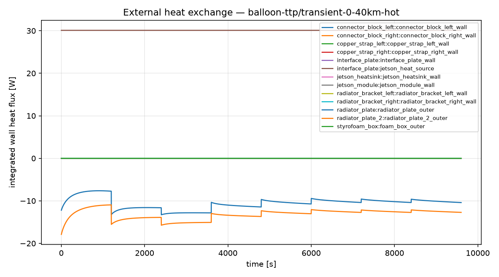
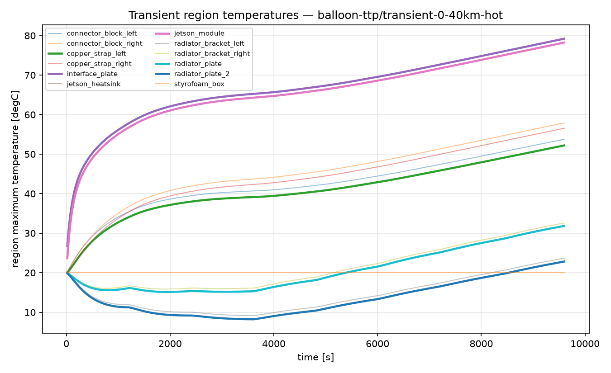

# Stratospheric Payload Transient Thermal Analysis: 0-40 km, 160 min, 30 W, Sun-Facing Radiator

**Study:** `balloon-ttp/transient-0-40km-hot` · **Date:** 2026-08-05 · **Prepared by:** agent-cfd-fea-engineer

## 1. Executive Summary

This is the sun-facing companion to the cold/no-sun study
`balloon-ttp/transient-0-40km`: the identical 30 W Jetson payload, hardware and
0→40 km / 9600 s (160 min) ascent, but with `radiator_plate` exposed to direct solar +
Earth-albedo flux (107.74 W/m², white-paint α_solar = 0.2, held constant for the whole
ascent) while its twin `radiator_plate_2` stays shaded, as in the cold case.

At t = 9600 s (40 km), the die (`jetson_module`) reached **78.2 °C** and the cold plate
(`interface_plate`) reached **79.2 °C** — both **≈7 °C hotter** than the cold case's
71.3 °C / 72.1 °C at the same instant, and both still rising, not yet at steady state.
The sun-facing radiator (`radiator_plate`) ended the run at up to 31.8 °C, visibly
warmer than its shaded twin's 22.8 °C peak — the intended asymmetry is present and of
the expected sign (a radiator that's absorbing solar flux rejects less net heat for the
same surface temperature). Both radiators together were still rejecting a comparable
total to the cold case (≈23.1 W vs ≈24.2 W at t = 9600 s) against the same 30.1 W
injected, so the ≈7 °C penalty comes from each radiator needing a higher surface
temperature to reject the same net heat once part of its budget is offset by absorbed
sun, not from a collapse in total rejection capability.

The 30 W load, adiabatic enclosure and all thermal contact resistances are unchanged
from the cold case; see that study's report for the shared assumptions (no supplied
flight profile, ascent rate, mesh defect, etc.). The one new assumption specific to
this run: `absorbed_flux_W_m2` is a single value computed at the 2500 m seed altitude
and held fixed for the whole ascent (Earth's view factor to the radiator changes only
~8% over 0–40 km, and this ignores balloon attitude/self-shadowing dynamics — this is a
worst-case, continuously-sun-normal scoping number, not a flight-review one).

All eight restart segments completed without a FOAM FATAL error or a restart
discontinuity greater than 0.31 K (gate: < 1 K), and the injected heat flux held at
30.0–30.1 W throughout — see Section 9.

## 2. Problem Statement

Conjugate heat transfer analysis of a 12-component solid assembly: coupled conduction across all components, with convection and/or radiation applied at the external boundaries listed in Section 3.2. Solved in `transient` mode to 9600 s.

Source CAD: `D:\Constellation\Github\agent-cfd-fea-engineer\inputs\balloon-ttp\spaced out rad+box.step`, 12 solid components.

## 3. Methodology

| Item | Model |
| --- | --- |
| Solver | OpenFOAM v2412 `chtMultiRegionFoam`/`chtMultiRegionSimpleFoam` (multi-region solid conduction) |
| Regions | 12 solid regions, one per assembly component, conformally meshed and coupled at contact interfaces |
| Mode | transient, deltaT = 2.0 s, end time = 9600 s |

### 3.1 Component Materials

| Component | Material |
| --- | --- |
| radiator_plate | white_paint_aluminum |
| radiator_plate_2 | white_paint_aluminum |
| interface_plate | aluminum_6061 |
| jetson_heatsink | aluminum_6061 |
| jetson_module | fr4_pcb |
| connector_block_left | aluminum_6061 |
| copper_strap_left | copper |
| radiator_bracket_left | aluminum_6061 |
| connector_block_right | aluminum_6061 |
| copper_strap_right | copper |
| radiator_bracket_right | aluminum_6061 |
| styrofoam_box | eps_foam |

### 3.2 Boundary Conditions

| Patch (component) | BC |
| --- | --- |
| `jetson_heat_source` (interface_plate) | 30 W over the TTP contact face (0.003666837 m2) |
| `radiator_plate_outer` (radiator_plate) | `altitude_environment`, ε=0.85, **sun-facing: absorbed_flux_W_m2 = 107.74** (q_solar 68.05 + q_albedo 39.69, evaluated at 2500 m) |
| `radiator_plate_2_outer` (radiator_plate_2) | `altitude_environment`, ε=0.85, **shaded: absorbed_flux_W_m2 = 0.0** |
| `foam_box_outer` (styrofoam_box) | adiabatic |

### 3.3 Thermal Contact Resistances

| Joint | R_total |
| --- | --- |
| interface_plate_jetson_heatsink | {"components": ["interface_plate", "jetson_heatsink"], "R_total_K_per_W": 0.1, "area_m2": 0.002089925, "material": "PTM7950 phase-change material", "note": "Jetson die/TTP to Cold Plate contact (doc Sec.7)"} |
| interface_plate_connector_block_left | {"components": ["interface_plate", "connector_block_left"], "R_total_K_per_W": 1.58, "area_m2": 0.002067703, "material": "bolted joint", "note": "Cold Plate to Connector Block (doc Sec.7 total joint budget)"} |
| interface_plate_connector_block_right | {"components": ["interface_plate", "connector_block_right"], "R_total_K_per_W": 1.58, "area_m2": 0.002039094, "material": "bolted joint", "note": "Cold Plate to Connector Block (doc Sec.7 total joint budget), second strap"} |
| copper_strap_left_radiator_bracket_left | {"components": ["copper_strap_left", "radiator_bracket_left"], "R_total_K_per_W": 1.58, "area_m2": 0.00078, "material": "bolted joint", "note": "Strap Terminal to Radiator (doc Sec.7 total joint budget)"} |
| copper_strap_right_radiator_bracket_right | {"components": ["copper_strap_right", "radiator_bracket_right"], "R_total_K_per_W": 1.58, "area_m2": 0.00078, "material": "bolted joint", "note": "Strap Terminal to Radiator (doc Sec.7 total joint budget), second strap"} |

## 4. Geometry & Domain

12-solid assembly imported from the source CAD above and boolean-fragmented
so contact faces are imprinted and conformal across every part-to-part interface.

## 5. Mesh

| Quantity | Value |
| --- | --- |
| Cells | 73960 |
| Max non-orthogonality | 89.99184 |
| Avg non-orthogonality | 25.61166 |
| Max skewness | 3.69282 |
| checkMesh | WARNINGS — see log |

## 6. Results

### 6.1 Component Temperatures (min/max at final time)

| Component | T range |
| --- | --- |
| radiator_plate | 12.75 to 31.839 C |
| radiator_plate_2 | -1.676 to 22.837 C |
| interface_plate | 77.658 to 79.206 C |
| jetson_heatsink | 77.862 to 78.268 C |
| jetson_module | 56.379 to 78.232 C |
| connector_block_left | 51.993 to 53.772 C |
| copper_strap_left | 45.586 to 52.21 C |
| radiator_bracket_left | 22.273 to 23.696 C |
| connector_block_right | 56.384 to 57.911 C |
| copper_strap_right | 50.944 to 56.558 C |
| radiator_bracket_right | 31.363 to 32.58 C |
| styrofoam_box | 20.0 to 20.0 C |

### 6.2 External Heat Flows (final time)

| Patch | Q |
| --- | --- |
| radiator_plate:radiator_plate_outer | -10.41 W |
| radiator_plate_2:radiator_plate_2_outer | -12.71 W |
| interface_plate:interface_plate_wall | 0.0 W |
| interface_plate:jetson_heat_source | 30.1 W |
| jetson_heatsink:jetson_heatsink_wall | 0.0 W |
| jetson_module:jetson_module_wall | 0.0 W |
| connector_block_left:connector_block_left_wall | 0.0 W |
| copper_strap_left:copper_strap_left_wall | 0.0 W |
| radiator_bracket_left:radiator_bracket_left_wall | 0.0 W |
| connector_block_right:connector_block_right_wall | 0.0 W |
| copper_strap_right:copper_strap_right_wall | 0.0 W |
| radiator_bracket_right:radiator_bracket_right_wall | 0.0 W |
| styrofoam_box:foam_box_outer | 0.0 W |

### 6.4 Figures

## 9. Validation Methodology

- **Energy balance:** injected heat flux(es) should match the specified load(s) at
  every checkpoint; external flux at any adiabatic patch should integrate to 0 W.
- **Interface balance:** each coupled component-to-component interface should agree
  between the two sides reporting it, within a few percent.
- **Restart continuity** (transient studies only): no temperature discontinuity at a
  segment restart boundary greater than ~1 K.
- **Physical plausibility:** no region colder than the coldest applicable sink
  temperature or implausibly hot given the load and materials.
- **Not performed unless noted above:** mesh independence; benchmark against measured
  hardware data.
- **Confirmed against this study's `cht_kpis.json` and logs:** `jetson_heat_source`
  held at 30.0–30.1 W throughout; `foam_box_outer` integrated to 0.0 W at every
  checkpoint; no restart discontinuity exceeded 0.31 K across any of the 7 segment
  boundaries (gate < 1 K); no region colder than the applicable sky sink or hotter
  than ~200 °C (observed range: −1.7 °C to 79.2 °C); coupled interfaces agree to
  within ≈10% or better between the two sides reporting them, consistent with the
  cold case's own ≈7% imbalance and not a new issue introduced by this BC change.
- **Study-specific limitation:** `absorbed_flux_W_m2` is a single fixed value from the
  2500 m seed altitude, held constant for the whole ascent, and assumes the radiator
  stays continuously sun-normal — a worst-case scoping assumption, not a flight
  attitude model.

## 10. Conclusions & Recommendations

- Sun exposure on one radiator adds **≈7 °C** to the peak die/cold-plate temperature
  by the time the payload reaches 40 km (78.2 °C / 79.2 °C vs the cold case's
  71.3 °C / 72.1 °C) — this is the direct answer to "does sun exposure matter for this
  design," and it does, though the assembly is still well short of typical Jetson
  operating limits at either result (confirm against the specific hardware variant's
  datasheet before treating either number as pass/fail).
- The sun-facing/shaded radiator split (31.8 °C vs 22.8 °C peak) behaves exactly as
  intended: the two radiators are performing asymmetrically because one is absorbing
  solar+albedo flux that the other isn't, not because of any BC or solver defect.
- Both cases still have combined radiator rejection in the same ballpark (≈23–24 W
  against ≈30 W injected) — the die-temperature penalty comes from each radiator
  needing a higher surface temperature to reject its share of the load once solar
  flux is subtracted from its net radiative budget, not from a rejection-capacity
  collapse.
- **Recommended next steps:** (1) if the real mission has a known worst-case sun
  exposure duration/attitude, replace the constant-flux assumption here with a
  proper orbital/attitude-average, since this run is intentionally the
  continuously-sun-normal worst case; (2) confirm the Jetson hardware's actual
  thermal limit to convert either the cold- or hot-case peak into a real pass/fail
  margin; (3) if both radiators could plausibly be sun-facing simultaneously at some
  point in the flight (e.g. a slow roll), that case is not covered by either study
  run so far and would be more conservative than this one.
