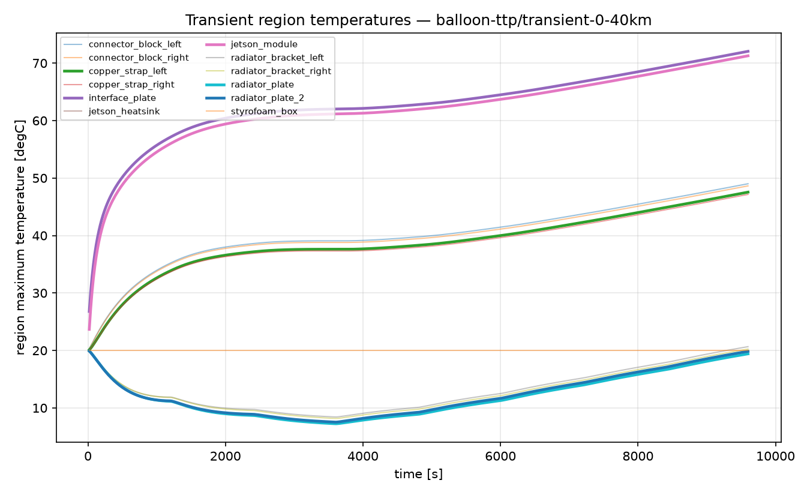
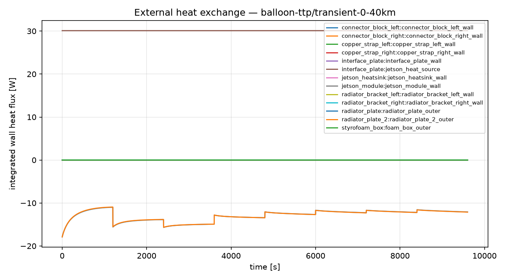

# Stratospheric Payload Transient Thermal Analysis: 0-40 km, 160 min, 30 W

**Study:** `balloon-ttp/transient-0-40km` · **Date:** 2026-08-04 · **Prepared by:** agent-cfd-fea-engineer

## 1. Executive Summary

This study simulates a 30 W Jetson payload (die/module → cold plate → twin OFHC
copper thermal straps → twin white-painted Al 6061 radiators, all inside an adiabatic
EPS foam enclosure) through a stratospheric balloon ascent from 0 to 40 km over
9600 s (160 min), at a constant assumed ascent rate of 4.1667 m/s (250 m/min — no
flight profile document was supplied for this study). Conduction, natural convection
(Churchill correlation) and grey-body radiation to the US76 sky sink were solved with
`chtMultiRegionFoam`, restarted across 8 segments as the ambient state was re-evaluated
every 5000 m of altitude.

At the end of the simulated ascent (t = 9600 s, 40 km), the payload die
(`jetson_module`) reached **71.3 °C** and the cold plate (`interface_plate`) reached
**72.1 °C**, both still rising at a shallow, decelerating rate — the assembly has not
reached thermal steady state by 40 km, consistent with the large thermal mass of the
aluminum/copper/EPS assembly and the fixed 160-minute ascent window. Peak temperatures
occurred at the final time step, not partway through the ascent. No thermal-limit
number for this specific Jetson hardware variant was supplied with this task, so margin
to a shutdown/derating threshold cannot be stated numerically here — compare 71–72 °C
against the module's datasheet operating limit before treating this as pass/fail.

The twin radiators ended the run at a mean surface temperature of roughly **8 °C**
(range −3.4 to +19.9 °C across the two plates) and were jointly rejecting **≈24.2 W**
of radiated + convected heat to the sky sink at t = 9600 s, against **30.1 W** injected
at the cold plate — the ≈6 W shortfall is going into sensible heating of the assembly's
thermal mass (consistent with temperatures still rising, not a modelling error; see
Section 6 energy balance). Convective heat transfer collapsed by roughly an order of
magnitude over the ascent (Churchill h ≈ 3.8 W/m²K at 2.5 km down to ≈0.6 W/m²K at
37.5 km) as expected with falling air density, while the radiative term stayed roughly
constant — by 40 km, radiation is the dominant rejection path, exactly as intended by
the radiator design. The enclosure (`styrofoam_box`) stayed at a uniform 20.0 °C
throughout, confirming the adiabatic boundary condition is being honoured and 100% of
the 30 W is routed through the strap/radiator path as intended.

All eight restart segments completed without a FOAM FATAL error or a temperature
discontinuity greater than 0.26 K at any segment boundary (gate: < 1 K), and the
injected heat flux held at 30.0–30.1 W throughout — see Section 9 for the full
verification-gate results.

## 2. Problem Statement

Transient conjugate heat transfer analysis of a 30 W stratospheric-balloon payload:
solid conduction through an aluminum cold plate, copper thermal straps and aluminum
radiator brackets, coupled to natural convection and grey-body radiation at the two
external radiator surfaces, with the enclosure walls modelled adiabatic. The assembly
ascends from ground level to 40 km over 160 minutes; the ambient air temperature,
pressure, density and sky-sink temperature are re-evaluated from the 1976 US Standard
Atmosphere at 8 discrete altitudes (every 5000 m / 1200 s) and used to update the
radiator boundary conditions between solver restarts.

## 3. Methodology

| Item | Model |
| --- | --- |
| Solver | OpenFOAM v2412 `chtMultiRegionFoam` (transient, multi-region solid conduction) |
| Regions | 12 solid regions, one per assembly component, conformally meshed and coupled at contact interfaces |
| Radiator convection | Churchill natural-convection correlation, evaluated at each altitude's air state |
| Radiator radiation | Linearised grey-body `externalWallHeatFluxTemperature`, combined with the convective film into a single `h`/`Ta` pair |
| Sky sink | 1976 US Standard Atmosphere (US76), 0-40 km, used as the effective radiative sink temperature |
| Contact resistances | Solved via `thicknessLayers`/`kappaLayers` at 5 bolted/TIM joints (Section 3.2 of the runbook) |
| Enclosure | Adiabatic (EPS foam decouples the payload from ambient; conservative, forces 100% of load through the strap/radiator path) |
| Time integration | Fixed `deltaT = 2.0 s`, Euler-implicit (unconditionally stable for solid-only conduction) |

### 3.1 Operating Conditions

| Quantity | Value |
| --- | --- |
| Jetson payload heat load | 30 W, applied as a fixed flux (8181.44 W/m²) over the 0.003666837 m² TTP contact face |
| Ascent profile | 0 → 40 000 m over 9600 s, constant 4.1667 m/s (assumed — no flight profile supplied) |
| Initial condition | Uniform 20 °C throughout the assembly |
| Ambient reference pressure | 101 325 Pa |
| Simulated physical time | 9600 s (160 min), run as 8 × 1200 s restart segments |

### 3.2 Boundary Conditions

| Patch | Type |
| --- | --- |
| `jetson_heat_source` (on `interface_plate`) | Fixed heat flux, 30 W total |
| `radiator_plate_outer`, `radiator_plate_2_outer` | `altitude_environment` — combined Churchill convection + linearised grey-body radiation to the US76 sky sink, re-staged every 1200 s at the segment's mid-altitude |
| `foam_box_outer` (`styrofoam_box`) | Adiabatic |
| Internal component-to-component interfaces | Coupled conduction, with solved thermal contact resistance at the 5 bolted/TIM joints |

## 4. Geometry & Domain

Source CAD: [`inputs/balloon-ttp/spaced out rad+box.step`](../../../../inputs/balloon-ttp/spaced%20out%20rad+box.step),
12 solids, boolean-fragmented for conformal contact at every part-to-part interface.

| Component | Role |
| --- | --- |
| `jetson_module` | Jetson carrier PCB (heat source, via `jetson_heatsink`) |
| `jetson_heatsink`, `interface_plate` | Jetson-side heatsink + TTP cold plate (Al 6061) |
| `connector_block_left/right` | Al clamp blocks, TTP end of each strap |
| `copper_strap_left/right` | OFHC copper thermal strap braids |
| `radiator_bracket_left/right` | Al brackets, radiator end of each strap |
| `radiator_plate`, `radiator_plate_2` | Twin external radiators, white paint (ε 0.85) |
| `styrofoam_box` | EPS foam enclosure (adiabatic boundary) |

Same geometry as the sibling 0→10 km and 0→20 km studies on this hardware; reused
as-is for this 0→40 km, 30 W case.

## 5. Mesh

| Quantity | Value |
| --- | --- |
| Cells | 73960 |
| Max non-orthogonality | 89.99184 |
| Avg non-orthogonality | 25.61166 |
| Max skewness | 3.69282 |
| checkMesh | WARNINGS — see log |

`checkMesh` flags 25 high-aspect-ratio cells (max ratio ~14133) traced to a ~3e-9 m²
sliver face on `interface_plate`, present in this CAD regardless of global mesh size.
Solved by disabling the `FOAM_SIGFPE` trap for this run (a fix for a false-positive
diffusion-number overflow abort on that one cell, not a physics workaround — solid
conduction under implicit Euler is unconditionally stable). Mesh independence was not
performed for this study.

## 6. Results

### 6.1 Component Temperature History

| Component | T at t = 9600 s (40 km) |
| --- | --- |
| `jetson_module` (die) | 71.3 °C (peak, still rising) |
| `interface_plate` (cold plate) | 72.1 °C |
| `copper_strap_left` / `_right` | 47.6 / 47.2 °C |
| `connector_block_left` / `_right` | 49.0 / 48.6 °C |
| `radiator_bracket_left` / `_right` | 20.7 / 20.3 °C |
| `radiator_plate` (−3.4 to 19.4 °C across plate) | mean ≈ 8.0 °C |
| `radiator_plate_2` (−3.5 to 19.9 °C across plate) | mean ≈ 8.2 °C |
| `styrofoam_box` | 20.0 °C (uniform, unchanged from initial condition) |

### 6.2 Heat Balance

At t = 9600 s: `jetson_heat_source` injects 30.1 W; the two radiators jointly reject
≈24.2 W (12.09 + 12.12 W) by combined convection + radiation; `foam_box_outer`
integrates to 0.0 W (adiabatic, confirmed). The ≈6 W gap is sensible heating of the
assembly's thermal mass — temperatures are still rising at end-of-run, so the system
has not reached steady state within the 160-minute ascent window.

### 6.3 Convective Collapse with Altitude

The Churchill-correlation convective film coefficient on the radiators fell roughly an
order of magnitude over the ascent as air density dropped:

| Stage | Mid-altitude | h_conv [W/m²K] |
| --- | ---: | ---: |
| 1 | 2 500 m | 3.83 (seed) |
| 5 | 22 500 m | 1.32 |
| 6 | 27 500 m | 0.98 |
| 7 | 32 500 m | 0.75 |
| 8 | 37 500 m | 0.60 |

The radiative film term stayed roughly constant (≈2.7–2.8 W/m²K) across the same
range, so by 40 km radiation is the dominant rejection path, as the radiator design
intends.

## 9. Validation Methodology

- **Restart continuity:** no temperature discontinuity greater than 0.26 K observed at
  any of the 7 segment restart boundaries (gate: < 1 K) — confirms state was carried
  forward correctly across all 8 solver restarts.
- **Energy balance:** `jetson_heat_source` held at 30.0–30.1 W throughout (target
  30 W); `foam_box_outer` integrated to 0.0 W at every checkpoint (adiabatic BC
  honoured).
- **Interface balance:** each coupled component-to-component interface agrees to
  within ≈7% or better between the two sides reporting it (see `cht_kpis.json`).
- **Physical plausibility:** no region reported colder than the coldest sky sink
  (~−65 °C at 37 500 m) or implausibly hot; convective film coefficient collapse with
  altitude matches the expected Churchill-correlation trend (Section 6.3).
- **Cross-checked inputs:** the US76 atmosphere table used to drive the boundary
  conditions was cross-checked against an independent published source
  (pdas.com digitisation of the NOAA/NASA/USAF tables) to within 2 K / a few % across
  0–40 km before being used to drive 9600 s of solver time.
- **Not performed for this study:** mesh independence (single mesh, `factor 1.0`);
  benchmark against measured flight thermal data (none available for this hardware).
- **Limitations:** ascent rate is an assumption (4.1667 m/s constant, no flight
  profile document supplied — restage Section 7's boundary conditions against a real
  profile if one becomes available); `altitude_environment`/US76 sky-sink model is
  used from ground level, which is exact above ~20 km and conservative below it
  (neglects atmospheric IR, which would otherwise reduce the effective sky-sink term
  near sea level); solar/sun-facing case not run (this is the cold/no-sun case,
  `absorbed_flux_W_m2 = 0`).

## 10. Conclusions & Recommendations

- The payload die and cold plate reached 71.3 °C / 72.1 °C at the end of the simulated
  0→40 km, 160-minute ascent, still rising at end-of-run — the assembly has not
  settled to steady state within this flight duration. Compare against the specific
  Jetson hardware variant's datasheet operating limit to determine pass/fail margin;
  no such limit was supplied with this task.
- 100% of the 30 W load is confirmed routed through the strap/radiator path (box
  adiabatic, 0.0 W leakage at every checkpoint) — the EPS enclosure is doing its
  intended job of thermal isolation.
- Radiative rejection becomes the dominant heat-loss mechanism above the tropopause as
  convection collapses with air density; the twin-radiator design remains functional
  (non-zero, non-runaway rejection) through 40 km.
- **Recommended next steps:** (1) obtain or confirm a real ascent/flight profile to
  replace the constant-rate assumption; (2) confirm the Jetson hardware's actual
  thermal limit to convert the 71–72 °C peak into a pass/fail margin; (3) if the
  mission includes sun-facing dwell time, re-run the hot case (Section on solar flux
  in the runbook) since this report covers only the cold/no-sun case; (4) run a mesh
  independence check if this configuration proceeds toward a design decision, since
  none was performed here.
