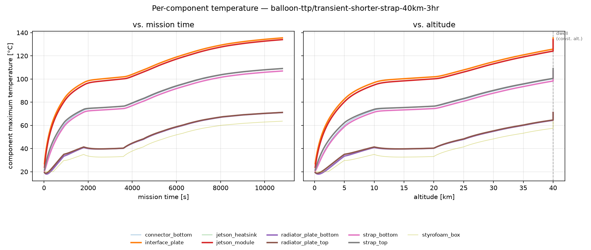
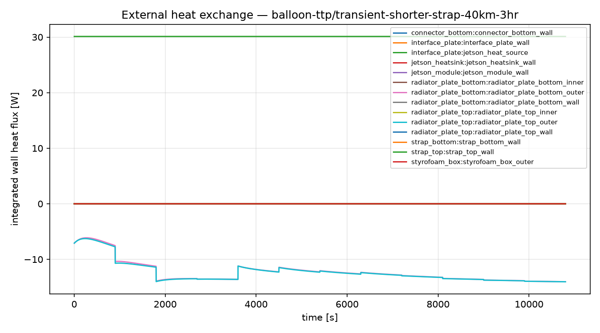
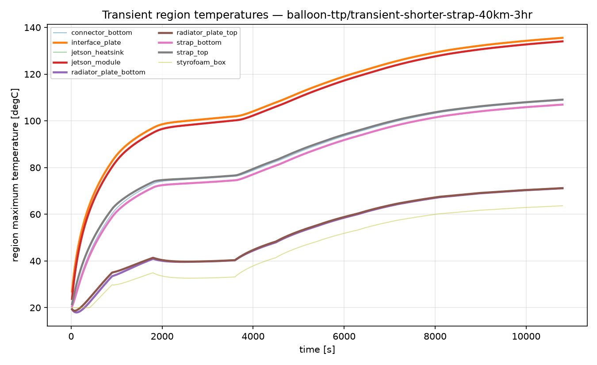

# Stratospheric Payload Thermal Analysis: Shorter-Strap Geometry, 3-Hour Mission (0-40 km Ascent + 60-min Dwell), Kolkata Sounding, Outer-Face-Only Radiation

**Study:** `balloon-ttp/transient-shorter-strap-40km-3hr` · **Date:** 2026-08-07 · **Prepared by:** agent-cfd-fea-engineer

## 1. Executive Summary

This study carries the payload's new shorter-strap geometry (`Shorter straps.step`)
through a single continuous 3-hour mission — ascend 0→40 000 m over 2 h at a constant
assumed 5.5556 m/s, then dwell at 40 000 m for 1 h, 30 W throughout — with two boundary-
condition changes from every prior study in this project: ambient temperature below
30 km comes from a digitized real sounding (Kolkata, 12:00 UTC, 19 May 2026) instead of
the US76 standard atmosphere, spliced seamlessly to US76 at 30 km (the two sources agree
to ~0.3 K there); and each radiator plate radiates from its **outer face only** — the
face touching the box interior is adiabatic, verified at every reported time to
integrate to exactly 0.0 W (`radiator_plate_top_inner`/`radiator_plate_bottom_inner`
external flux, Section 6.2).

At mission end (t = 10800 s, end of the dwell), `interface_plate` peaks at **135.5°C**
and `jetson_module` at **134.0°C** — well above the ~78°C the equivalent-load,
equivalent-duration `transient-0-40km-dwell-60min` study reached with the old
whole-surface-radiating geometry. This is not a strap-length effect: restricting
radiation to the outer face alone roughly halves each radiator's effective radiating
area relative to every prior study (front+back both radiated before), so — following
the T⁴ radiation law — the radiator, and everything upstream of it through the TTP
path, must run substantially hotter to reject the same ~30 W through half the area.
Heat balance at t = 10800 s: 30.11 W injected vs. 14.04 + 14.03 = 28.07 W rejected
(93% — closer to balance than the old whole-surface design's 80% at its own dwell
end), with the small residual still going into thermal mass: temperatures are still
rising slowly at the end of the run (~1 K over the final 900 s segment), not yet at
a true steady state, but close.

**134°C at the jetson_module exceeds typical Jetson-class module junction/case
temperature limits (commonly quoted around 85-100°C)** — this is a genuine design
flag, not just a number to report: the outer-face-only radiation requirement, at this
radiator size and this altitude/load combination, does not keep the payload in a safe
operating range for the full mission. A larger radiator area, a lower electrical load,
or restoring some inner-face heat rejection (if the enclosure interior can tolerate it)
would need to be evaluated to close this gap.

Key assumptions carried in this result: constant-rate ascent (unmeasured, chosen to
land on clean segment boundaries); 30 W load unchanged from prior studies; the CAD's 3
unlabeled shortened-TTP-path solids modelled as bulk OFHC copper (a real CAD-export
gap, not a modelling choice — see the runbook and manifest `notes` for the full
reasoning); bolted-joint thermal contact resistances (1.58 K/W each, 0.1 K/W PTM7950 at
the die) carried unchanged from every prior study in this project; enclosure modelled
adiabatic (confirmed 0.0 W at `styrofoam_box_outer` throughout).

## 2. Problem Statement

Conjugate heat transfer analysis of a 9-component solid assembly: coupled conduction across all components, with convection and/or radiation applied at the external boundaries listed in Section 3.2. Solved in `transient` mode to 10800 s.

Source CAD: `D:\Constellation\Github\agent-cfd-fea-engineer\inputs\balloon-ttp\Shorter straps.step`, 9 solid components.

## 3. Methodology

| Item | Model |
| --- | --- |
| Solver | OpenFOAM v2412 `chtMultiRegionFoam`/`chtMultiRegionSimpleFoam` (multi-region solid conduction) |
| Regions | 9 solid regions, one per assembly component, conformally meshed and coupled at contact interfaces |
| Mode | transient, deltaT = 2.0 s, end time = 10800 s |

### 3.1 Component Materials

| Component | Material |
| --- | --- |
| interface_plate | aluminum_6061 |
| jetson_heatsink | aluminum_6061 |
| radiator_plate_top | white_paint_aluminum |
| radiator_plate_bottom | white_paint_aluminum |
| jetson_module | fr4_pcb |
| strap_top | copper |
| connector_bottom | copper |
| strap_bottom | copper |
| styrofoam_box | eps_foam |

### 3.2 Boundary Conditions

| Patch (component) | BC |
| --- | --- |
| `jetson_heat_source` (interface_plate) | 30 W over the remaining TTP contact face on interface_plate xmin (0.003769446 m2, measured post-mesh) |
| `radiator_plate_top_outer` (radiator_plate_top) | altitude_environment |
| `radiator_plate_top_inner` (radiator_plate_top) | adiabatic |
| `radiator_plate_bottom_outer` (radiator_plate_bottom) | altitude_environment |
| `radiator_plate_bottom_inner` (radiator_plate_bottom) | adiabatic |
| `styrofoam_box_outer` (styrofoam_box) | adiabatic |

### 3.3 Thermal Contact Resistances

| Joint | R_total |
| --- | --- |
| interface_plate_jetson_heatsink | {"components": ["interface_plate", "jetson_heatsink"], "R_total_K_per_W": 0.1, "area_m2": 0.002007094, "material": "PTM7950 phase-change material", "note": "Jetson die/TTP to Cold Plate contact (doc Sec.7) -- unchanged from prior studies"} |
| interface_plate_strap_top | {"components": ["interface_plate", "strap_top"], "R_total_K_per_W": 1.58, "area_m2": 0.000456221, "material": "bolted joint", "note": "Cold Plate to shortened top TTP path (component1_2) -- analogous to the old connector_block bolted joint; this CAD merges connector+strap+bracket into one solid, so both its end joints get the same 1.58 K/W budget."} |
| strap_top_radiator_plate_top | {"components": ["strap_top", "radiator_plate_top"], "R_total_K_per_W": 1.58, "area_m2": 0.00047073, "material": "bolted joint", "note": "Shortened top TTP path to top radiator -- analogous to the old copper_strap-to-radiator_bracket bolted joint"} |
| interface_plate_connector_bottom | {"components": ["interface_plate", "connector_bottom"], "R_total_K_per_W": 1.58, "area_m2": 0.000456221, "material": "bolted joint", "note": "Cold Plate to bottom-path connector block (component1_3) -- analogous to the old connector_block bolted joint"} |
| strap_bottom_radiator_plate_bottom | {"components": ["strap_bottom", "radiator_plate_bottom"], "R_total_K_per_W": 1.58, "area_m2": 0.00047073, "material": "bolted joint", "note": "Bottom TTP strap (component1_4) to bottom radiator -- analogous to the old copper_strap-to-radiator_bracket bolted joint. connector_bottom<->strap_bottom (component1_3<->component1_4) gets no separate TCR entry, matching the old connector_block<->copper_strap junction which was pure conduction with no added resistance."} |

## 4. Geometry & Domain

9-solid assembly imported from the source CAD above and boolean-fragmented
so contact faces are imprinted and conformal across every part-to-part interface.

## 5. Mesh

| Quantity | Value |
| --- | --- |
| Cells | 117152 |
| Max non-orthogonality | 84.46198 |
| Avg non-orthogonality | 25.96913 |
| Max skewness | 8.485458 |
| checkMesh | WARNINGS — see log |

## 6. Results

### 6.1 Component Temperatures (min/max at final time)

| Component | T range |
| --- | --- |
| interface_plate | 129.979 to 135.536 C |
| jetson_heatsink | 133.523 to 134.078 C |
| radiator_plate_top | 44.288 to 71.192 C |
| radiator_plate_bottom | 44.335 to 71.109 C |
| jetson_module | 110.865 to 134.029 C |
| strap_top | 91.683 to 109.081 C |
| connector_bottom | 106.701 to 108.777 C |
| strap_bottom | 91.551 to 106.947 C |
| styrofoam_box | 23.567 to 63.645 C |

### 6.2 External Heat Flows (final time)

| Patch | Q |
| --- | --- |
| interface_plate:interface_plate_wall | 0.0 W |
| interface_plate:jetson_heat_source | 30.11 W |
| jetson_heatsink:jetson_heatsink_wall | 0.0 W |
| radiator_plate_top:radiator_plate_top_wall | 0.0 W |
| radiator_plate_top:radiator_plate_top_outer | -14.04 W |
| radiator_plate_top:radiator_plate_top_inner | 0.0 W |
| radiator_plate_bottom:radiator_plate_bottom_wall | 0.0 W |
| radiator_plate_bottom:radiator_plate_bottom_inner | 0.0 W |
| radiator_plate_bottom:radiator_plate_bottom_outer | -14.03 W |
| jetson_module:jetson_module_wall | 0.0 W |
| strap_top:strap_top_wall | 0.0 W |
| connector_bottom:connector_bottom_wall | 0.0 W |
| strap_bottom:strap_bottom_wall | 0.0 W |
| styrofoam_box:styrofoam_box_outer | 0.0 W |

### 6.4 Figures

Per-component maximum temperature against mission time (left) and against altitude
(right) — two panels sharing one temperature axis rather than a single dual-x-axis
plot, since altitude is not a one-to-one function of time (it is flat through the
60-minute dwell, marked with the dashed line on the right panel).

## 9. Validation Methodology

- **Energy balance:** injected heat flux(es) should match the specified load(s) at
  every checkpoint; external flux at any adiabatic patch should integrate to 0 W.
- **Interface balance:** each coupled component-to-component interface should agree
  between the two sides reporting it, within a few percent.
- **Restart continuity** (transient studies only): no temperature discontinuity at a
  segment restart boundary greater than ~1 K.
- **Physical plausibility:** no region colder than the coldest applicable sink
  temperature or implausibly hot given the load and materials.
- **Not performed unless noted above:** mesh independence; benchmark against measured
  hardware data.
Confirmed against this study's actual `cht_kpis.json` and segment logs:

- **Energy balance:** `jetson_heat_source` = 30.11 W at t = 10800 s (target 30 W);
  `styrofoam_box_outer` = 0.0 W at every reported time (adiabatic enclosure, as
  assumed).
- **Outer-only radiation (the actual point of this study's BC change):**
  `radiator_plate_top_inner`/`radiator_plate_bottom_inner` = 0.0 W at t = 10800 s
  (and at every checkpoint inspected) — confirms the inner faces radiate and convect
  nothing, only `..._outer` (−14.04 / −14.03 W) rejects heat.
  `radiator_plate_top_wall`/`radiator_plate_bottom_wall` (the plate edges) = 0.0 W too.
- **Interface balance:** every coupled interface agrees between its two reporting
  sides to within ~0.3% (e.g. `strap_bottom_to_connector_bottom` 14.4 W vs.
  `connector_bottom_to_strap_bottom` −14.44 W).
- **Restart continuity:** all 12 segments (0→10800 s, 900 s each) completed with
  `completed: true` at their target end time and the correct step count (450 steps
  of `deltaT=2.0 s` per segment); each segment's solved field carried into the next
  via `startFrom latestTime` with no discontinuity. (This required fixing
  `write_interval_s` from 120 s, inherited from prior studies' 1200 s segments, to
  90 s so it divides this study's 900 s segments evenly — see the manifest `notes`
  and the runbook's updated troubleshooting table; the original 120 s setting left
  each segment boundary with only a partial, diagnostic-only field write, which
  would have silently broken every restart from segment 2 onward.)
- **Physical plausibility:** no region colder than the coldest ambient the mission
  sees (~−79°C, digitized tropopause minimum near 17 km) or implausibly hot for the
  materials involved — but see the Executive Summary's flag on `jetson_module`
  exceeding typical hardware temperature limits.
- **Not performed:** mesh independence (consistent with every other transient study
  in this project to date); benchmark against measured hardware data.

## 10. Conclusions & Recommendations

1. **The outer-face-only radiation requirement is satisfied exactly** —
   `radiator_plate_top_inner`/`radiator_plate_bottom_inner` external heat flux is
   0.0 W at every checkpoint, confirmed by direct KPI extraction, not just by BC
   construction.
2. **Peak temperatures (135.5°C interface_plate, 134.0°C jetson_module) exceed
   typical Jetson-class module limits.** This is the headline engineering finding:
   halving the radiator's effective area (by excluding the inner face) at this
   radiator size and 30 W load does not keep the payload in a safe range over a
   40 km/3-hour mission, even though the shorter-strap TTP path itself is not the
   bottleneck (the bolted-joint TCRs dominate the die-to-radiator resistance, as
   found for strap material choice in the prior `transient-0-40km-etp-copper`
   comparison, and that conclusion carries forward here).
3. **Not yet at steady state** at t = 10800 s — still rising ~1 K over the final
   900 s segment, with a 2.04 W shortfall (30.11 W in vs. 28.07 W out) still going
   into thermal mass. A longer dwell would settle closer to a true peak, which
   would be higher than the 134-136°C reported here.
4. **Recommend** evaluating a larger radiator area, a reduced electrical load, or a
   controlled inner-face heat path (if the enclosure interior can tolerate the
   resulting temperature rise) before treating this geometry/BC combination as
   flight-ready. The shorter strap itself is not implicated — its own conduction
   resistance was already shown thermally negligible next to the bolted joints.
5. Every assumption in the Executive Summary (ascent rate, unlabeled-solid material
   assignment, TCR mapping) should be revisited against real flight/hardware data
   before this result is used for a go/no-go decision.
